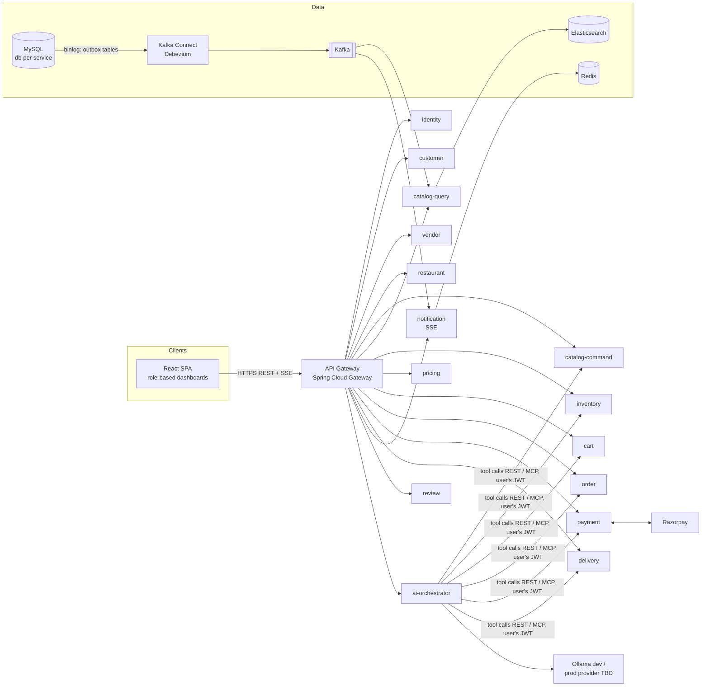
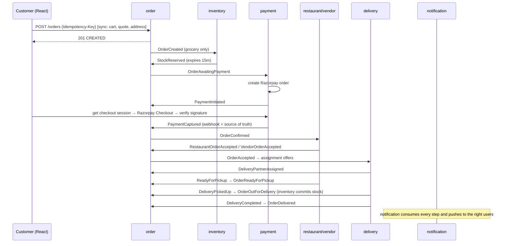
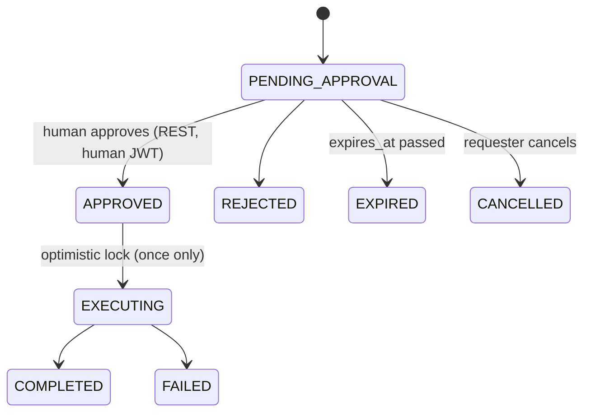

# Grocery AI Platform — Architecture Proposal & Implementation Plan

## Context

`d:\Drive E\dev\grocery-ai-app` contains only `grocery-ai-agent-prompt.txt`, a blueprint for an enterprise grocery + restaurant commerce platform with 5 stakeholders (Admin, Customer, Vendor, Restaurant Owner, Delivery Partner), Java/Spring Boot microservices, MySQL as source of truth, Kafka + Debezium, Elasticsearch, Redis, Spring AI agents with human approval, and a React/TypeScript/Tailwind frontend. No existing code is present, so there is nothing to preserve.

The blueprint (§20) asks for an architecture proposal first, with no code, and then **one phase at a time with your approval between phases**. This document is that proposal. After you approve it, I implement **Phase 1 only**, then stop for review.

### Decisions you already made (Q&A)
| Topic | Your choice | Consequence in this plan |
|---|---|---|
| Service granularity | **All 16 services separate** | 16 independent Spring Boot apps, each with its own pom, DB, Dockerfile. Each phase runs only the services it needs (RAM). |
| Order saga | **Pure choreography** | No central coordinator. order-service owns the order *status* (reacts to events). Each participant owns its own timeouts. `OrderCancelled` is the single compensation trigger. |
| LLM | **Ollama (local) for dev** | Spring AI `ChatClient` makes the provider a config switch. Production provider decided later. |
| Payments | **Razorpay** (test mode) | INR, amounts in paise at the gateway boundary, Razorpay Orders API + Checkout + signed webhooks. |
| Local runtime (change request) | **Everything runs in Docker; nothing installed as a Windows service** | **One MySQL container holds all 13 service databases** (memory-tuned). Kafka, Debezium Connect, Elasticsearch, Redis, Kafka UI, **Ollama**, all 16 Spring Boot services and the React dev server run as Docker containers from one Compose setup. Compose profiles start only what a phase needs. |

### Requirements deferred until you approve (blueprint §13–§15)
- **Implemented now:** Spring Boot Actuator, unit tests, integration tests, Docker Compose for local development.
- **Also now, per your change request:** a Dockerfile and local container for every service and the frontend.
- **Not implemented until you approve:** Micrometer/Prometheus/Grafana/Loki/OTel/tracing/alerting, API/Kafka/contract/E2E/security/performance/AI/approval test suites, CI image pipelines and vulnerability scanning, Jenkins, ECR, ECS, AWS.

### First step after approval
Save this proposal into the project as **`d:\Drive E\dev\grocery-ai-app\DEVELOPMENT_PLAN.md`** (same content), then start Phase 1.

---

## 1. Understanding of the business requirements

- **Two-sided marketplace with two fulfillment types.**
  - **Grocery orders:** fulfilled by a vendor, with counted stock that must be reserved.
  - **Restaurant orders:** fulfilled by a restaurant. Menu availability is a flag, not a counted stock. The restaurant accepts or rejects and then prepares the food.
  - Both types share cart, checkout, payment, delivery, notifications and AI.
- **Five stakeholders, each with their own dashboard.** Admin is the platform operator. Approvals and monitoring sit on admin sub-roles (Operations, Finance, Delivery Manager, Support).
- **Real-time is a first-class need.** Status changes must reach the right people only, without a page refresh.
- **AI is a controlled helper, not an autonomous actor.** It reads freely through backend tools. Anything with money or operational impact goes through an approval that a human makes and the backend verifies.

### Scale: what "1M registered customers" actually means
| Measure | Definition | Estimate at 1M registered |
|---|---|---|
| Registered users | Accounts that exist | 1,000,000 |
| Monthly active users | Used the app in the month (~20%) | ~200,000 |
| Daily active users | Used the app that day (~5%) | ~50,000 |
| Concurrent users | Online at the same instant (peak hour ≈ 25% of daily users, ~10 min sessions) | **~2,000** |
| Requests per second | API calls hitting the gateway (1 call per ~4 s per active user, ×2 headroom) | **~500–1,000 RPS** at peak |
| Peak transactions | Orders per second (~15% of daily users order → 7.5k/day; peak hour 20%; ×10 promo burst) | **~0.5/s normal, ~5/s burst** |
| Kafka events | ~20 events per order + location pings (~750 active deliveries × 1 per 5 s) | **~250 msg/s** peak |

**Conclusion:** this is a modest load. Two replicas per service, smallest instance sizes, a single small Kafka cluster and one MySQL instance per tier are enough for years. The architecture scales by adding replicas and partitions and by splitting databases, not by redesigning. Launch traffic (thousands of users) is tiny.

---

## 2. Recommended architecture



**Core principles**
- Each service owns its data. Every domain change and its event are written in one MySQL transaction, into the business tables plus an `outbox_event` table.
- **Debezium is the only outbox relay.** It reads each service's outbox table from the MySQL binlog, and its Outbox Event Router sends each event to Kafka. Services never call Kafka producers for business events, so there are no lost events and no two-phase commit.
- **Synchronous REST is used only when the user needs an answer right now:** login, search, cart/price quote at checkout, creating the Razorpay checkout session. Everything after the order is created moves through events.
- **Virtual threads** (`spring.threads.virtual.enabled=true`) with plain Spring MVC in business services keep the code simple and imperative. WebFlux is used only inside the Gateway.

### Technology stack and why each piece is there
| Tech | Purpose | Version target (pinned/verified at Phase 1) |
|---|---|---|
| Java | Language | **Java 25 LTS** |
| Spring Boot | Service framework | Latest GA 4.x |
| Spring Cloud | **Gateway** (routing, JWT check, rate limit) and **CircuitBreaker/Resilience4j** (timeouts and breakers on sync calls) | Release train matching Boot |
| *Not used:* Eureka, Config Server, Spring Cloud Stream | Docker DNS and ECS Service Connect already provide discovery. Profiles plus env vars/Secrets Manager provide config. Plain Spring Kafka is more explicit than Stream. | — |
| Spring AI | Agents, tool calling, structured output, chat memory | Version compatible with the Boot line |
| MySQL | Source of truth | 8.4 LTS (binlog ROW + GTID for Debezium) |
| Flyway | Schema migrations per service | Boot-managed |
| Kafka | Event backbone | 4.x, KRaft (no ZooKeeper) |
| Debezium | Outbox relay and catalog CDC → ES | 3.x on Kafka Connect |
| Elasticsearch | Catalog and restaurant search (fuzzy, autocomplete, facets, geo) | 8.x/9.x matching Spring Data Elasticsearch |
| Redis | Cart store, cache, rate limits, SSE fan-out (pub/sub), live partner locations (GEO), token denylist | 7.4+/8 |
| Ollama | Local LLM for dev | `ollama/ollama` Docker container; model volume persisted; NVIDIA GPU passthrough through Docker Desktop/WSL2 if available, otherwise CPU |
| React, TypeScript, Tailwind, React Router, TanStack Query | Frontend | React 19, Vite, Tailwind 4, Router 7, Query 5 |
| Razorpay | Payments | `razorpay-java` SDK + Checkout.js |

---

## 3. Microservices and their responsibilities

Ports: Gateway on 8080. Services on 8101–8115 in table order. Kafka Connect stays on its default 8083.

| # | Service | Business responsibility / main features | Data store | Publishes (topic: events) | Consumes | Sync calls out | Scaling notes |
|---|---|---|---|---|---|---|---|
| 1 | **api-gateway** | Routing, JWT validation, rate limiting, CORS, correlation ID, suspended-user denylist, SSE pass-through | Redis | — | — | all services | Stateless; scale on RPS |
| 2 | **identity-service** | Register/login, JWT (RS256) + JWKS, refresh-token rotation, roles, stakeholder claims (`vendor_id`, `restaurant_id`, `partner_id`), service tokens (client credentials) | identity_db | `identity.events`: UserRegistered, UserSuspended, UserReactivated | vendor/restaurant/delivery Approved/Suspended (to update claims and revoke tokens) | — | Read-heavy JWKS (cached by consumers) |
| 3 | **customer-service** | Customer profile, addresses (lat/lng), preferences | customer_db | `customer.events`: CustomerProfileUpdated | UserRegistered (CUSTOMER) | — | Low |
| 4 | **vendor-service** | Vendor onboarding/KYC, approval status, **vendor order operations** (accept/pack/ready), sales reports, purchase/supply (later) | vendor_db | `vendor.events`: VendorRegistered/Approved/Rejected/Suspended, VendorOrderAccepted/Rejected/ReadyForPickup | UserRegistered (VENDOR), OrderConfirmed (grocery), OrderCancelled | — | Low |
| 5 | **restaurant-service** | Restaurant profile, hours, **menu + menu prices + item availability**, incoming orders (accept/reject/preparing/ready), acceptance timeouts, sales reports | restaurant_db | `restaurant.events`: RestaurantApproved/Suspended, RestaurantListingUpdated (profile + menu snapshot), RestaurantOrderAccepted/Rejected/Preparing/ReadyForPickup | OrderConfirmed (restaurant), OrderCancelled, DeliveryPartnerAssigned | — | Peaks at mealtimes |
| 6 | **catalog-command-service** | Write side: categories (admin), brands, vendor-owned products, images (URL for MVP), attributes, publish/unpublish, full republish for reindexing | catalog_db | `catalog.events`: ProductUpserted (full snapshot, also for archive), CategoryChanged | VendorSuspended (unpublish) | — | Low write rate |
| 7 | **catalog-query-service** | Read side: product and restaurant search, autocomplete, facets, geo search, product detail | **Elasticsearch** (no MySQL) | — | catalog, pricing, inventory, vendor, restaurant, review events | — | Scale on search RPS |
| 8 | **inventory-service** | Stock per vendor product, adjustments ledger, **reservations with TTL**, commit on pickup, low-stock alerts | inventory_db | `inventory.events`: StockReserved, StockReservationFailed, StockReservationExpired, StockReleased, StockCommitted, ProductAvailabilityChanged (in/out transitions only), LowStockDetected | OrderCreated (grocery), OrderCancelled, OrderOutForDelivery | — | Hot-row contention → atomic conditional UPDATE |
| 9 | **pricing-service** | Grocery product prices, price history, approval of large price changes, price **quote API**, promotions/coupons (later) | pricing_db + Redis cache | `pricing.events`: PriceChanged, PriceChangeRequested/Approved/Rejected | — | — | Read-heavy → cache |
| 10 | **cart-service** | Cart per customer (single store per cart), totals via quote | **Redis** (TTL 30 days) | — | OrderCreated (clear cart) | pricing (quote), restaurant (menu quote) | Read/write-heavy, ephemeral |
| 11 | **order-service** | Place order (idempotent), order status owner and state guards, cancellation rules, order history, admin order monitoring and stats, order timeline | order_db | `order.events`: OrderCreated, OrderAwaitingPayment, OrderConfirmed, OrderAccepted, OrderReadyForPickup, OrderOutForDelivery, OrderDelivered, OrderCancelled, OrderRejected | inventory, payment, vendor, restaurant, delivery events | cart (read), pricing/restaurant (quote), customer (address) — at creation only | Core; scale on order rate |
| 12 | **payment-service** | Razorpay order creation, checkout session, signature verification, webhooks, payment timeout, refunds, reconciliation | payment_db | `payment.events`: PaymentInitiated, PaymentCaptured, PaymentFailed, PaymentExpired, RefundCompleted, RefundFailed | OrderAwaitingPayment, OrderCancelled | Razorpay API | Must be correct, not fast |
| 13 | **delivery-service** | Partner onboarding/availability, assignment (nearest available, offers with expiry), pickup/deliver/fail, location tracking, history, reassignment | delivery_db + Redis GEO | `delivery.events`: DeliveryPartnerApproved/Suspended, DeliveryCreated, DeliveryOfferCreated, DeliveryPartnerAssigned, DeliveryPickedUp, DeliveryCompleted, DeliveryFailed, DeliveryAssignmentFailed; `delivery.location` (best-effort) | OrderAccepted, OrderReadyForPickup, OrderCancelled | — | Location pings are the highest write rate |
| 14 | **notification-service** | Recipient resolution, notification inbox, **SSE connections**, Redis pub/sub fan-out, (later) email/SMS/push | notification_db + Redis | — | Almost all event topics | — | Scale on open connections |
| 15 | **review-service** | Ratings/reviews for products, restaurants and delivery; eligibility (delivered orders only), moderation, rating summaries | review_db | `review.events`: ReviewSubmitted, RatingSummaryUpdated | OrderDelivered | — | Low (**built in Phase 12**) |
| 16 | **ai-orchestrator-service** | 5 agents, tool registry/guard, chat memory, **approval engine**, AI audit | ai_db | `ai.events`: ApprovalRequested, ApprovalDecided, ApprovalExecuted/Failed | — | Business services via REST (tools) | LLM-bound; rate-limited per user |

**Ownership choices.** Restaurant menu prices stay in restaurant-service, together with the menu. pricing-service covers grocery prices and future promotions. There is **no admin-service**: the admin UI calls each service's `/api/admin/**` endpoints, and platform settings live in the service that owns each one.

**Independent deployment.** Each service has its own Maven build, Dockerfile, Flyway migrations and Debezium connector config. Event contracts are versioned and readers ignore unknown fields. A service can be released without coordinating with the others.

**When each service is built.** Services are scaffolded and built in the phase that needs them (see §13). review-service is built post-MVP.

---

## 4. Database ownership strategy

- **One database per service**: `identity_db, customer_db, vendor_db, restaurant_db, catalog_db, inventory_db, pricing_db, order_db, payment_db, delivery_db, notification_db, review_db, ai_db`. cart-service uses only Redis and catalog-query-service uses only ES.
- **Local:** **a single MySQL Docker container** with 13 databases and **13 database users, each granted only its own schema**. Cross-service access is impossible even on a laptop. A dedicated `debezium` user has replication rights and SELECT on outbox tables only.
  - The container is tuned for low memory: `innodb_buffer_pool_size=256M`, `performance_schema=OFF`, `max_connections=300`, `mem_limit` ≈ 768 MB.
  - Data lives in a named Docker volume.
  - Databases and users are created by an init script on first start.
- **Production:** start with one RDS instance holding separate schemas and users. Move busy or critical services (order, payment, inventory) to their own instances when load or blast radius justifies it. Apps don't change, only connection strings.
- **Flyway** per service under `src/main/resources/db/migration`. Every DB gets `outbox_event` and `processed_event` tables in V1.
- **Keys:** application-generated **UUIDv7** stored as `BINARY(16)`. It is time-ordered, so it suits InnoDB, and the ID exists before insert, which is needed for outbox rows and idempotency. Foreign keys only within a service. Other services' IDs are plain columns without FKs.
- **Money:** `DECIMAL(12,2)` + currency `INR`. Converted to paise only at the Razorpay boundary. All timestamps are UTC `DATETIME(6)`.
- **Optimistic locking (`@Version`)** on product, price, order, payment, delivery, approval_request.
- **Inventory reservation** uses an atomic conditional update instead of lock-retry loops: `UPDATE stock_item SET available=available-?, reserved=reserved+? WHERE id=? AND available>=?` (0 rows → out of stock).
- **Idempotency:**
  - **APIs:** `Idempotency-Key` header on create order, payment verify, refund and approval decisions. Stored in an `idempotency_key` table (unique key + request hash + saved response).
  - **Consumers:** `processed_event(event_id, consumer)` is inserted in the same transaction as the business change.
- **Timeouts and scheduled work** (reservation expiry, payment expiry, acceptance deadline, offer expiry) use deadline columns plus a `@Scheduled` poller with `SELECT … FOR UPDATE SKIP LOCKED`. This is safe with multiple replicas and needs no extra library.
- **Eventual consistency:** read models (ES, notification inbox, vendor/restaurant order projections) lag by milliseconds to seconds. Anything that matters (price, stock) is re-checked against its owner at checkout.
- **No distributed transactions.** Each step is a local transaction plus an outbox event, and compensations are domain events (see §5).

---

## 5. Kafka event-driven architecture

**Outbox through Debezium (all services).** The outbox table has these columns: `id` (eventId), `aggregate_type`, `aggregate_id`, `event_type`, `event_version`, `payload` JSON, `correlation_id`, `causation_id`, `occurred_at`.

There is one Debezium MySQL connector per service. Its config file lives in the service folder, so the service stays independently deployable. The `EventRouter` transform:
- sends each event to `<aggregate_type>.events`
- uses `aggregate_id` as the message key
- puts version, correlation and causation IDs in headers

A cleanup job deletes outbox rows older than 7 days.

**Catalog → Elasticsearch through Debezium (meets §6 of the blueprint).** catalog-command writes a **ProductUpserted event carrying the full denormalized product snapshot** (product, category path, brand, images, vendor) to its outbox. Debezium streams it to `catalog.events`, and catalog-query's indexer upserts it into ES with `version_type=external`, so stale events are ignored. Price and stock events update their own fields, each guarded by its own version.

*Why not raw table CDC:* raw row changes would expose catalog_db's internal schema and force the read side to join product, category and image changes itself. The outbox event is a stable contract. It is still Debezium CDC from MySQL to ES. A full reindex is an admin "republish all" call on catalog-command.

**Topics and partitioning.**
- One topic per domain: `identity.events, customer.events, vendor.events, restaurant.events, catalog.events, pricing.events, inventory.events, order.events, payment.events, delivery.events, review.events, ai.events`.
- Plus `delivery.location`: high-frequency, best-effort, sent directly without the outbox, 1-hour retention.
- **Key = aggregate ID**, which gives per-order and per-product ordering within a topic.
- Partitions: 3 locally, 6–12 in production. Production settings: replication factor 3, `min.insync.replicas=2`, idempotent producers.
- **Consumer groups** are named `<service>.<purpose>` (e.g., `order-service.saga`, `catalog-query.indexer`). Replicas never exceed partitions.

**Reliability.**
- **Idempotent consumers** use `processed_event` plus state-machine guards, so duplicates and replays are harmless.
- **Retries:** Spring Kafka `DefaultErrorHandler` with exponential backoff and **blocking** retries on order-critical consumers (keeps ordering). Non-blocking retry topics are allowed only for notifications.
- **Dead letters:** non-retryable errors (validation, deserialization) go straight to `<topic>.DLT`. A replay tool comes in Phase 10.
- **Versioning:** `eventVersion` header. Additive changes stay within a version, and readers ignore unknown fields. A breaking change means a new version published side by side during migration. The event catalog lives in `docs/events/`.
- **Cross-topic ordering is not guaranteed** (e.g., PaymentCaptured can arrive after OrderCancelled). Consumers apply state guards and compensate. A late capture on a cancelled order is refunded automatically.

### Order flow — choreography (happy path)

For restaurant orders, order-service checks menu availability and open status synchronously when the order is created, then emits `OrderAwaitingPayment` immediately. There is no stock reservation.

**Order statuses:** `CREATED → AWAITING_PAYMENT → CONFIRMED → ACCEPTED → PREPARING → READY_FOR_PICKUP → OUT_FOR_DELIVERY → DELIVERED`. Terminal states: `REJECTED, CANCELLED, DELIVERY_FAILED`. Refund status is tracked separately in payment-service.

### Failure, timeout, cancellation and compensation
| Scenario | Who detects it | What happens |
|---|---|---|
| Out of stock | inventory → StockReservationFailed | Order REJECTED(OUT_OF_STOCK); no payment is created; customer notified |
| Payment declined | payment → PaymentFailed | Order stays AWAITING_PAYMENT; customer can retry until the reservation expires |
| Payment not completed in 15 min | payment timeout → PaymentExpired | order emits OrderCancelled(PAYMENT_TIMEOUT) → inventory releases stock |
| Reservation expires first | inventory → StockReservationExpired | Order cancelled → payment marks the session dead |
| Late capture after cancellation | payment (captured for a cancelled order) | Automatic refund → RefundCompleted |
| Restaurant/vendor rejects | restaurant/vendor → …Rejected | OrderCancelled(REJECTED) → refund + stock release + delivery cancel |
| No acceptance before deadline (configurable, e.g., 5 min) | restaurant/vendor timeout poller | Auto-reject → same as above |
| No delivery partner after N offers / radius expansion | delivery → DeliveryAssignmentFailed | Delivery manager alerted; manual assignment; otherwise admin cancels with refund (**approval**) |
| Customer cancels before acceptance | order API | OrderCancelled → full refund, stock released |
| Customer cancels after acceptance | order API | Becomes a cancellation request → restaurant/admin decides; partial refund per policy |
| Delivery failed (customer unreachable) | delivery → DeliveryFailed | Order DELIVERY_FAILED → admin decides refund (**approval**); grocery items returned to vendor stock |
| Refund API failure | payment | Retry with backoff → RefundFailed → admin queue |
| Webhook lost or delayed | payment reconciliation job (Phase 10) | Fetches Razorpay status for pending payments |
| Consumer service down | — | Kafka keeps the events; the consumer catches up on restart. The outbox guarantees nothing is lost. |
| Duplicate or out-of-order events | every consumer | Dedup with `processed_event`; state guards; compensation where needed |

**Choreography vs orchestration (your choice: choreography).** Orchestration is the better fit when a workflow has many conditional branches, strict end-to-end SLAs, or compensations that must happen in a precise order. It is also better when the business wants one place to see and change the process.

Choreography works here because of four safeguards:
1. order-service is the single owner of order status.
2. `OrderCancelled` is the single compensation trigger.
3. Each participant owns its own timeouts.
4. Phase 10 adds a **stuck-order watchdog** and an **order timeline** view.

If the flow later becomes hard to follow, the events are designed as facts, so order-service can be turned into an orchestrator without changing the participants much.

---

## 6. Real-time communication architecture

**Transport: Server-Sent Events (SSE), not WebSocket.**
- Updates only flow from server to browser. Browser actions, including delivery location pings every 5–10 s, are plain REST calls.
- SSE is ordinary HTTP, so it passes through Spring Cloud Gateway and the AWS load balancer easily.
- `Last-Event-ID` resume is built into the protocol.
- AI chat streaming reuses the same SSE mechanism.

```mermaid
flowchart LR
  K[[Kafka events]] --> N1[notification replica A]
  K -. same consumer group: each event handled once .-> N2[notification replica B]
  N1 -->|1 resolve recipients<br/>2 store in inbox (MySQL)<br/>3 PUBLISH| RP[(Redis pub/sub)]
  RP --> N1 & N2
  N1 -->|SSE to locally connected users| U1[Users on A]
  N2 -->|SSE| U2[Users on B]
```

**How notification-service handles one event**
1. **Consume each event once** (one consumer group).
2. **Resolve recipients on the server.** Events carry stakeholder IDs (customerId, vendorId, restaurantId, partnerId). A local projection maps each stakeholder ID to user IDs. Admins use the `role:ADMIN` channel.
3. **Store persistent notifications** in the MySQL inbox. The inbox ID is used as the SSE event ID.
4. **Publish** to Redis pub/sub. Every replica receives the message and delivers it only to users connected to that replica. No connection registry is needed.

**Two kinds of messages**
- **Persistent notifications** (new order, status changes, approvals): stored in the inbox and replayed on reconnect using `Last-Event-ID`.
- **Ephemeral live signals** (rider location, stock in/out, dashboard counters): not stored. On reconnect the client refetches through React Query invalidation. The server sends the signal; the API provides the actual data.

**Authorization**
- The stream is authenticated with the JWT. A fetch-based SSE client sends the `Authorization` header plus `Last-Event-ID`.
- Channels are computed on the server (`user:{id}`, `role:ADMIN`, `public:catalog`). Clients never subscribe to arbitrary topics.
- The server closes the stream when the token expires; the client reconnects with a fresh token and backoff.
- Heartbeat every 20 s.

**Not broadcasting everything**
- Stock changes are pushed only on in-stock/out-of-stock transitions, throttled, on `public:catalog`.
- Order events go only to that order's customer, store and partner, plus an admin feed.

**How the blueprint's examples are handled**
- **Vendor updates stock:** inventory emits a transition event; it goes to the public catalog channel plus the admin feed.
- **Restaurant accepts:** customer and admin receive it.
- **Customer places an order:** the restaurant's board updates and plays a sound.
- **Partner accepts:** restaurant, customer and admin receive it.
- **Admin suspends a vendor:**
  - identity revokes the vendor's refresh tokens and adds them to the gateway denylist in Redis.
  - catalog-query hides the vendor's products.
  - The vendor's open session gets a "suspended" event and is closed.

---

## 7. Agentic AI and human approval architecture

**Structure.** One ai-orchestrator-service hosts 5 agent definitions. Each definition has:
- a system prompt
- a tool allowlist
- the role allowed to use it
- model options

The agent is chosen from the **user's role**, not by the LLM: Customer→Shopping, Vendor→Vendor Mgmt, Restaurant Owner→Restaurant Ops, Delivery Partner/Manager→Delivery Ops, Admin→BI.

**Request path (confirmed by you)**
```
User → API Gateway → Agent Orchestrator (Spring Boot + Spring AI) ← LLM (Ollama) → Tool calls (REST / MCP) → Product · Inventory · Cart · Order · Payment · Delivery

React chat → API Gateway (JWT check, revoked-token check, rate limit) → POST /api/ai/{agent}/chat (SSE stream)
  → ai-orchestrator: ChatClient (Spring AI; Ollama locally) + ChatMemory (JDBC, MySQL ai_db, last-N window)
  → model requests a tool → ToolGuard:
       1. tool in this agent's allowlist?   2. user role/permission ok?   3. args valid (schema + business limits)?
       4. risk class: READ → execute | LOW_RISK_WRITE → execute + audit | SENSITIVE → create ApprovalRequest (do NOT execute)
  → tool call over the private network, carrying the USER's JWT (the AI never has more rights than the user):
       REST  — @Tool methods in the orchestrator call the service's normal REST API (typed HTTP interface clients)
       MCP   — the domain service exposes its own tools on an MCP server endpoint (Spring AI MCP server, Streamable HTTP,
               same JWT resource-server security); the orchestrator is an MCP client and applies the same ToolGuard
  → each domain service validates the JWT and enforces its own authorization (zero trust — in place since Phase 2)
  → every tool call audited (ai_tool_invocation: user, agent, tool, transport, args, result summary, latency, status)
```
- **REST vs MCP.**
  - **REST tools are the default** in Phase 11. They are typed, easy to test, and reuse existing APIs.
  - **MCP** is used where a domain team should own its AI tools next to its code, and where the tools should be reusable by other MCP clients (e.g., an admin's desktop assistant). Pilot: catalog (product search) and order (order status).
  - Sensitive operations are **never** exposed as directly executable MCP or REST tools. They exist only as `propose_*` tools that create approval requests.
  - Before Phase 11 starts, verify that per-request user-token propagation works on the Spring AI MCP client (request customizer).
- **Structured output:** Spring AI `.entity(Record.class)`. Examples: BI insight reports, product suggestion lists, restock suggestions.
- **Context:** each request injects user context (role, address, cart summary, store ID) into the system prompt. The context window is bounded and long conversations are summarized later.
- **AI never touches MySQL directly.** Its own `ai_db` stores only conversations, audit records and approvals.

**Operation risk classification**
| Agent | Automatic (READ / low-risk) | Requires human approval (who approves) |
|---|---|---|
| Customer Shopping | Search, compare, recommend, order status, add/remove cart items | **Place order** (customer); cancel order (customer); return request (customer) |
| Vendor Mgmt | Sales and inventory insights, restock suggestions, draft product text | **Stock changes, price changes** (vendor); price change > threshold also needs admin |
| Restaurant Ops | Order queue summary, sales insights, prep suggestions | **Accept/reject exceptional orders, mark items unavailable** (owner) |
| Delivery Ops | Next-step guidance, history, earnings | **Reassignment** (delivery manager) |
| Admin BI | KPIs, trends, anomaly insights (structured) | **Refunds** (finance admin), **suspensions, config changes** (admin); above a threshold a second admin approves (four-eyes) |

**Approval lifecycle:** `PENDING_APPROVAL → APPROVED → EXECUTING → COMPLETED`, plus `REJECTED, EXPIRED, FAILED, CANCELLED`.


**Approval rules**
- **Bound to the exact action.** `approval_request` stores the action type, target endpoint, canonical JSON parameters and their **SHA-256 hash**. It also records the requester, agent, conversation, required approver role and expiry.
- **The summary comes from the server, not the LLM.** The explanation shown to the approver is built from the exact parameters by a server template. The model's rationale is shown separately, so a misleading model description cannot change what is approved.
- **AI cannot approve.** There is no approve tool. Approval happens only through `POST /api/approvals/{id}/approve` with a human JWT holding the required role. The approver is recorded with who, what and when, plus a comment.
- **Execution is checked again by the target service.**
  1. The orchestrator moves the request to EXECUTING (optimistic lock, so it runs once).
  2. It calls the target service with a service token plus a signed `X-Approval-Token` (approvalId, action, params hash, on-behalf-of user, approver, expiry) and `Idempotency-Key = approvalId`.
  3. The target service checks the signature, that the action matches the endpoint, and that the request-body hash matches.
  4. It records the approvalId as consumed, so it cannot be used twice.
  5. Only then does it execute.
- **Paying still needs the customer.** An AI-placed order still requires the customer to pay in Razorpay Checkout.

**Safety and resilience**
- Tool results such as product descriptions and reviews are treated as untrusted data (prompt injection), and the backend enforces authorization anyway.
- Model output is rendered as sanitized markdown, never as raw HTML.
- Each user has a request rate limit and a token budget, and every LLM call has a timeout.
- If the LLM is down, the chat shows a fallback message. **AI is never on the ordering critical path.**
- With Ollama, tool calling must be validated with a tool-capable model (Qwen/Llama 8B class, chosen in Phase 11). ToolGuard validation protects against malformed calls.

---

## 8. React frontend architecture

**Recommendation: one React app** with role-based route areas, each lazy-loaded so code is split per role. This is the simplest option: one login, one shared design system and API client.

The folder layout keeps each role area self-contained. If independent releases are needed later, they can be extracted into separate apps in a pnpm workspace (`apps/*`, `packages/shared`) without a rewrite.

**Libraries**
- Vite, React 19, TypeScript, Tailwind 4, React Router 7
- TanStack Query (server state)
- React Hook Form + Zod (forms and validation)
- TanStack Table (tables)
- Recharts (dashboards)
- Leaflet + OpenStreetMap (tracking map)
- Accessible headless UI primitives (Radix through copy-in shadcn/ui components)
- No Redux. Auth, session and realtime use React context.

**Cross-cutting pieces**
- **API client:** one axios instance with a refresh-on-401 interceptor and one shared refresh in flight.
- **Typed API modules**, one per service.
- **Session:** the access token is kept **in memory only**. The refresh token is an httpOnly, Secure, SameSite=Strict cookie, and a silent refresh runs on load.
- **Route guards:** `RequireRole` on routes, plus a navigation menu built from the user's role.
- **RealtimeProvider:**
  - SSE client with reconnect, backoff and `Last-Event-ID`.
  - Maps each event type to the React Query cache keys it invalidates.
  - Feeds the notification center and toasts.
- **Shared components:** loading and error states (skeletons, error boundary, retry), pagination, search and filter bar, data table, stat tiles and charts.
- **AI chat panel** (streaming) with approval cards; **Approvals inbox** page.
- **Delivery partner UI:** mobile-first PWA using geolocation `watchPosition`. Tracking works in the foreground only; a native app is a later option.

---

## 9. Security architecture

| Concern | Design |
|---|---|
| Authentication | identity-service with Spring Security; passwords hashed with BCrypt/Argon2; login rate limit + temporary lockout; audit of login/failed/role changes |
| Access token | JWT RS256, 15 min, claims: `sub`, `roles`, `vendor_id`/`restaurant_id`/`partner_id`, `jti`; JWKS endpoint |
| Refresh token | Opaque 256-bit random value, stored hashed, **rotated on every use**; reuse of an old token revokes the whole token family; httpOnly cookie scoped to `/api/auth` |
| Gateway | Validates JWT, checks Redis denylist (suspended users take effect immediately), rate limiting per user/IP (Redis), CORS limited to the frontend origin, strips client-supplied identity headers, adds `X-Correlation-Id` |
| Services | Each service is also a JWT resource server (validates through JWKS) — zero trust, no blind trust in the gateway. `@PreAuthorize` for role checks plus **ownership checks in the service layer** (a vendor can only change products where `vendor_id` = its claim) |
| Roles | CUSTOMER, VENDOR, RESTAURANT_OWNER, DELIVERY_PARTNER, ADMIN sub-roles: SUPER_ADMIN, OPS_ADMIN, FINANCE_ADMIN, SUPPORT, DELIVERY_MANAGER. Role→permission mapping lives in each service's code |
| Service-to-service | User-initiated calls forward the user's JWT. Background/system calls use **client-credentials service tokens** from identity-service with scopes/audience. Production adds private subnets and security groups (TLS between services later) |
| CSRF / CORS | Bearer-token APIs don't need CSRF protection. The cookie-based refresh endpoint uses SameSite=Strict, an Origin check and a required custom header |
| Input validation | Jakarta Bean Validation on DTOs; RFC 9457 ProblemDetail errors that hide internal details; page-size caps |
| Payments | Card data never reaches our servers (Razorpay Checkout); checkout signature HMAC is verified; webhook `X-Razorpay-Signature` is verified and webhook event IDs are de-duplicated; key secret only in payment-service |
| Secrets | Local `.env` (git-ignored, `.env.example` committed); production uses AWS Secrets Manager (later) |
| AI | ToolGuard (allowlist + role + argument validation + risk class), user JWT forwarding, signed single-use approval tokens, full audit |
| Audit | Each service keeps its own record of sensitive actions (identity's sign-in audit, settings history, the events naming an admin's decision); since 2026-11-21 one central search over all of them: reporting-service's audit trail, `GET /api/admin/audit` ([docs/api/audit-trail.md](docs/api/audit-trail.md)) |

**Data access by stakeholder**
- **Customers** see only their own profile, cart and orders.
- **Vendors and restaurants** see only data tied to their own ID claim.
- **Delivery partners** see only offers and deliveries assigned to them.
- **Admins** see everything, but finance, operations and support actions each require the matching sub-role.

---

## 10. Search, caching and performance

- **Elasticsearch, honestly assessed.** For ~1,000 products, MySQL FULLTEXT could handle plain keyword search. ES earns its place for:
  - typo tolerance (fuzziness AUTO)
  - autocomplete (`search_as_you_type`)
  - synonyms ("curd"/"yogurt", "atta"/"wheat flour")
  - relevance boosts (in-stock, rating)
  - facets
  - **geo distance combined with text** for ~1,000 restaurants and their menus
  - keeping read traffic off MySQL

  The cost is one more stateful system and a lag of about a second. It is kept because you require it and because it supports these features, not because of raw load.
- **Indexes:**
  - `products`: name/description analyzers, synonyms, category path, brand, vendorId, price, inStock, rating.
  - `restaurants`: geo_point, cuisine, open status, nested menu item names.
- **MySQL indexes follow the queries**, e.g. `(customer_id, created_at)`, `(restaurant_id, status, created_at)`, `(status, deadline_at)` for the pollers.
- **Pagination:** keyset (cursor) pagination for large lists such as order history and admin feeds; offset pagination for small admin tables; ES `search_after` for deep search pages. The maximum page size is 100.
- **Redis cache (cache-aside):**
  - Each entry has a TTL and is cleared when its change event arrives.
  - Cached: price lookups, restaurant menus, category tree.
  - Search results are not cached, because ES is already fast.
- **Connections:** small HikariCP pools (≈10 per instance), sized against MySQL `max_connections` across services and replicas. RestClient connect timeout 1 s and read timeout 2–3 s; Resilience4j breakers on sync calls; retries only on idempotent reads.
- **Kafka throughput:** keys spread evenly across partitions; Debezium producer uses lz4 compression and batching; consumer concurrency equals partition count. ~250 msg/s at the 1M-user target is light work.

---

## 11. Infrastructure, deployment, observability and testing

**Local (now): everything runs in Docker Compose — nothing is installed as a Windows service.**

Only Docker Desktop (WSL2) is required. A JDK and Node are optional, for IDE support.

| Container | Image | Memory cap (approx.) | Notes |
|---|---|---|---|
| mysql | `mysql:8.4` | 768 MB | **One container, all 13 databases**; binlog ROW + GTID; tuned buffer pool; named volume |
| kafka | `apache/kafka` (KRaft, single broker) | 768 MB | Two listeners: `kafka:29092` (containers) and `localhost:9092` (host tools) |
| kafka-connect | `debezium/connect` (or Debezium's current image) | 768 MB | Connectors registered by a one-shot init container |
| elasticsearch | `elasticsearch` single node | 1 GB (heap 512 MB) | Security off locally only |
| redis | `redis` | 128 MB | `maxmemory` + LRU |
| kafka-ui | `kafbat/kafka-ui` | 256 MB | Dev tool: topics, DLTs, consumer lag |
| ollama | `ollama/ollama` | 3–6 GB (model-dependent) | Profile `ai`; model pulled by an init container into a persistent volume; GPU if NVIDIA is available |
| 16 services | Built from each service's Dockerfile | 320–384 MB each | `JAVA_TOOL_OPTIONS="-XX:MaxRAMPercentage=75 -XX:+UseSerialGC -XX:TieredStopAtLevel=1 -Xss512k"`, Spring profile `docker` |
| frontend | `node` (Vite dev server) | 300 MB | Source bind-mounted; file-watch polling enabled (needed on Windows mounts) |

- **Compose profiles keep memory low.**
  - Infrastructure containers always start.
  - Ollama uses profile `ai`.
  - Services are grouped by phase: `identity`, `catalog`, `inventory`, `cart`, `orders`, `realtime`, `fulfillment`, `delivery`, `review`, `ai`, `frontend`. `all` starts everything.
  - Example: `docker compose --profile identity --profile frontend up -d`.
- **RAM budget:**
  - Infrastructure ≈ 3.5 GB; all 16 services ≈ 5.5 GB; Ollama 3–6 GB; frontend 0.3 GB.
  - With everything running ≈ 13–15 GB inside the WSL2 VM.
  - **32 GB machine recommended.** Set `.wslconfig` `memory=20GB`. A typical phase needs far less.
- **Image builds:** multi-stage Dockerfiles. Stage 1 is Maven with a BuildKit cache mount for `~/.m2`; it installs `libs/grocery-common`, then packages the service. Stage 2 is a JRE runtime with a non-root user.
  - The build context is the repo root, with a root `.dockerignore` excluding `target/`, `node_modules/` and similar.
  - No local JDK or Maven is needed to build. Rebuild one service with `docker compose up -d --build order-service`.
- **Two Spring profiles per service:**
  - `docker`: container hostnames `mysql`, `kafka:29092`, `redis`, `elasticsearch`, `ollama`.
  - `local`: localhost ports. Used when you stop one service's container and run it from the IDE to debug, with everything else still in Docker. Alternatively, attach a debugger to a container's JDWP port, which is enabled through an env flag.
- **Still deferred to the DevOps phase:** CI image pipelines, image vulnerability scanning, pushing to ECR, and AWS.

**Production target (deferred, needs approval)**
- AWS ECS Fargate behind an ALB; ECR; RDS MySQL; Amazon MSK + MSK Connect (Debezium); ElastiCache; Elastic Cloud *or* Amazon OpenSearch (see decisions); S3 + CloudFront for the SPA; Secrets Manager.
- Jenkins pipeline per service: build → test → scan → image → deploy.
- Blue-green deploys through ECS/CodeDeploy; Flyway runs at startup with backward-compatible migrations (expand/contract) so rollback works.
- Kubernetes only if service count, team size or cost later justify it.

**Observability now:** Actuator `/health` (liveness/readiness) and `/info`. **Proposed, needs your OK:** correlation-ID propagation (gateway → MDC → Kafka headers) plus Spring Boot's built-in structured JSON logging. Both are configuration-level, almost free, and essential for debugging choreography.

**How to troubleshoot an order today:**
1. Look up the order ID in the order timeline (status history plus the events that caused each change).
2. Grep logs by correlation ID.
3. Check Kafka UI for DLT messages and consumer lag.

Later this becomes OTel traces in Grafana.

**Testing now**
- **Java:** JUnit 5, Mockito, AssertJ unit tests; integration tests with `@SpringBootTest`, `@DataJpaTest`, `@WebMvcTest` and **Testcontainers MySQL** (Flyway migrations run in the tests).
- **React:** Vitest, React Testing Library, MSW.

**Testing later (needs approval):** REST Assured, Testcontainers Kafka, Spring Cloud Contract/Pact, Playwright, OWASP ZAP and dependency-check, Gatling/k6, AI tool-execution tests, approval-workflow tests.

---

## 12. Project directory structure

```
grocery-ai-app/
├── README.md                          # how to run everything
├── DEVELOPMENT_PLAN.md                # this proposal (saved first, after approval)
├── .gitignore  .editorconfig  .dockerignore
├── docs/
│   ├── architecture/                  # 01-high-level … 10-deployment (Mermaid + plain-language explanation each)
│   ├── adr/                           # 0001-database-per-service.md, 0002-debezium-outbox.md, 0003-choreography.md …
│   └── events/event-catalog.md        # every topic, event, version, payload, producer, consumers
├── infrastructure/
│   ├── local/
│   │   ├── docker-compose.yml         # infra + ollama + 16 services + frontend, grouped by profiles
│   │   ├── .env.example               # ports, passwords, Razorpay test keys, Ollama model
│   │   │                              # MySQL tuning (binlog/GTID, low memory) = command flags in compose:
│   │   │                              # a my.cnf bind-mounted from Windows is world-writable and MySQL ignores it
│   │   ├── mysql/init/01-databases-and-users.sql   # 13 DBs + per-service users + debezium user
│   │   ├── kafka/create-topics.sh     # run by a one-shot init container
│   │   ├── debezium/register-connectors.sh         # one-shot init container posts each service's connector JSON
│   │   └── ollama/pull-model.sh       # one-shot init container pulls the dev model
│   └── aws/                           # later, after approval
├── libs/
│   └── grocery-common/                # SEPARATE versioned library (own pom; mvn install) — NOT multi-module/parent
│       └── src/main/java/com/grocery/common/{outbox,event,idempotency,security,web,correlation}/
├── services/
│   ├── api-gateway/
│   ├── identity-service/   customer-service/   vendor-service/   restaurant-service/
│   ├── catalog-command-service/   catalog-query-service/   inventory-service/   pricing-service/
│   ├── cart-service/   order-service/   payment-service/   delivery-service/
│   ├── notification-service/   review-service/   ai-orchestrator-service/
│   └── (each service, e.g. order-service/)
│       ├── pom.xml  mvnw  .mvn/  Dockerfile  README.md
│       ├── deploy/debezium-connector.json
│       └── src/
│           ├── main/java/com/grocery/order/
│           │   ├── OrderServiceApplication.java
│           │   ├── config/  controller/  dto/  entity/  repository/  service/  mapper/
│           │   ├── exception/            # @RestControllerAdvice → ProblemDetail
│           │   ├── event/{publisher,consumer,payload}/
│           │   ├── client/               # @HttpExchange interfaces (RestClient)
│           │   └── security/
│           ├── main/resources/{application.yml, application-docker.yml, application-local.yml, db/migration/V1__init.sql}
│           └── test/java/...             # unit + Testcontainers integration
└── frontend/
    └── grocery-web/
        ├── package.json  vite.config.ts  tsconfig.json  index.html  Dockerfile (dev server)
        └── src/
            ├── app/            # App.tsx, router.tsx, providers.tsx, queryClient.ts
            ├── shared/         # api/, auth/, realtime/, components/ui/, hooks/, utils/, types/
            ├── features/       # catalog/, cart/, orders/, notifications/, ai-chat/, approvals/, analytics/
            └── roles/          # customer/, vendor/, restaurant/, delivery/, admin/  (lazy-loaded routes + pages)
```

**Conventions**
- Each service uses `spring-boot-starter-parent` directly.
- Java records for DTOs and event payloads; MapStruct for mappers.
- Each consumer defines its own event DTO with only the fields it needs. Domain classes are never shared through grocery-common.
- The OpenAPI UI is enabled in the local profile.

---

## 13. Implementation phases

Kafka, the outbox and Debezium are part of the **foundation** (Phase 1), not Phase 9, because catalog search (Phase 3) and orders (Phase 6) depend on them. Real-time moves **before** restaurant and delivery operations, which need it. The blueprint's Phase 9 becomes "event hardening."

| Phase | Name | Services | MVP? |
|---|---|---|---|
| 1 | Architecture docs & infrastructure foundation | gateway, identity (skeleton), grocery-common, frontend shell | ✅ |
| 2 | Identity & stakeholder management | identity, customer, vendor, restaurant, delivery (partner profile) | ✅ |
| 3 | Product catalog & search (Debezium → ES) | catalog-command, catalog-query, restaurant (menus) | ✅ |
| 4 | Inventory & pricing | inventory, pricing | ✅ |
| 5 | Cart & checkout preview | cart | ✅ |
| 6 | Orders & payments (Razorpay) | order, payment | ✅ |
| 7 | Real-time updates (SSE) | notification | ✅ |
| 8 | Vendor & restaurant fulfillment | restaurant, vendor | ✅ |
| 9 | Delivery management | delivery | ✅ |
| 10 | Event-driven hardening | all | partial |
| 11 | Agentic AI & human approval | ai-orchestrator (+ approval checks in targets) | ✅ (Shopping + Admin agents) |
| 12 | Reviews & postponed business features | review + others | post-MVP |
| 13 | Observability, extended testing, performance | — | needs your approval |
| 14 | CI/CD (Jenkins) & AWS | — | needs your approval |

**Phase 1 — Foundation**
- **Objectives:** a runnable local platform skeleton plus architecture documentation.
- **Docs:** `docs/architecture/` with all 10 Mermaid diagrams from blueprint §18, each explained in plain language; ADRs; event catalog skeleton.
- **Infrastructure (all Docker):** `infrastructure/local/docker-compose.yml` with profiles, health checks and memory limits.
  - Single MySQL container with an init script creating 13 DBs, least-privilege users and the debezium user.
  - Kafka, Debezium Connect, Elasticsearch, Redis, Kafka UI.
  - Ollama container (profile `ai`).
  - One-shot init containers for topics, connectors and the model pull.
- **grocery-common library:**
  - outbox writer and entity
  - event envelope and headers
  - idempotent consumer helper
  - Idempotency-Key support
  - JWT resource-server autoconfig
  - ProblemDetail handler
  - correlation filter (if approved)
- **Services (containerized):**
  - api-gateway: routes, CORS, correlation ID.
  - identity-service skeleton: Flyway V1 with outbox and processed_event tables, health, Debezium connector.
  - Each has a multi-stage Dockerfile and `docker`/`local` profiles.
- **Frontend (containerized dev server):** Vite, TS, Tailwind, Router, Query; app shell, role-layout placeholders, API client, UI primitives, error/loading components.
- **Acceptance criteria:**
  - `docker compose --profile identity --profile frontend up -d --build` brings every container to healthy.
  - The connector reports RUNNING.
  - Inserting a row into `identity_db.outbox_event` produces a message on `identity.events` with key and headers (visible in Kafka UI).
  - `GET :8080/api/identity/actuator/health` goes through the gateway container.
  - Tests pass inside Docker.
  - The frontend container serves the shell on `:6420` with hot reload.
  - `docker compose --profile ai up -d` starts Ollama and its API answers.

**Phase 2 — Identity & stakeholders**
- **DB:**
  - identity_db: user_account, role, user_role, refresh_token, stakeholder_link, login_audit
  - customer_db: customer, address
  - vendor_db / restaurant_db / delivery_db: profile, documents, status_history
- **APIs:**
  - `/api/auth/{register,login,refresh,logout}`, `/.well-known/jwks.json`
  - `/api/customers/me`, `/api/customers/me/addresses`
  - `/api/vendors/me`, `/api/restaurants/me`, `/api/delivery/partners/me`
  - `/api/admin/{vendors,restaurants,delivery-partners}/{id}/{approve,reject,suspend,reinstate}`, `/api/admin/users`
- **Events:** UserRegistered/Suspended; Vendor/Restaurant/DeliveryPartner Registered/Approved/Rejected/Suspended. identity consumes approvals to issue claims and suspensions to revoke tokens and update the denylist.
- **Frontend:** login and register (choose role), guarded role areas, customer profile and addresses, onboarding forms, admin approval queues and user list.
- **Acceptance criteria:**
  - Every role can register and log in.
  - Refresh rotation works, and reusing an old refresh token revokes the token family.
  - A vendor calling an admin API gets 403.
  - An approval activates the stakeholder claim.
  - A suspension blocks the very next request.
- **Tests:** unit (token service, rotation); integration (auth flow and repositories with Testcontainers).
- **As built (decisions made during Phase 2):** contract in `docs/api/phase-2-identity-and-stakeholders.md`.
  - **Registration flow:**
    - `UserRegistered` is published through the outbox. Each stakeholder service creates its own DRAFT profile for its role.
    - The first save also creates the profile on demand, so onboarding never depends on event timing.
  - **Claims:**
    - identity keeps a `business_membership` copy built from vendor and restaurant events. Only APPROVED businesses become `vendor_id` / `restaurant_id` claims.
    - customerId and delivery partnerId equal the userId, so no claim is needed.
  - **Immediate revocation:** instead of a blanket denylist, identity writes `auth:revoked-before:<userId>` (epoch ms) to Redis.
    - The gateway rejects older tokens (`iat_ms`) with `401 TOKEN_REVOKED`, and the client refreshes into current claims.
    - If Redis is down, the check fails open (tokens expire within 15 min anyway).
  - **Refresh tokens:** rotation with a 10 s grace window for concurrent tabs (`409 REFRESH_RACE`). Later reuse revokes the session family.
  - **Zero trust:** every service validates the JWT itself (grocery-common resource-server auto-configuration). The gateway adds an edge rule `/api/admin/**` → admin roles.
    - This is what the AI orchestrator's REST/MCP tool calls rely on in Phase 11.
  - **Gateway:**
    - CORS lives in the security chain, so error responses also carry CORS headers.
    - Redis rate limits: per user, and per IP on `/api/auth/**`.
    - Spoofable headers are stripped.
    - A dead service → `503 SERVICE_UNAVAILABLE`; a timeout → `504`.
    - `/api/health/{service}` routes back the System Status page.
  - **Kafka consumers:** blocking retries (1, 2, 4, 8 s) then `<topic>.DLT`. Invalid events go to the DLT immediately. Correlation and causation IDs are put into the MDC.
  - **Delivery partners:** DELIVERY_MANAGER may also approve or suspend them.
  - **Mappers:** plain Java instead of MapStruct; with records, the mapping code is a few lines.
  - **Compose:** profile `core` = gateway + identity + customer + vendor + restaurant + delivery.
  - **End-to-end check:** `infrastructure/local/scripts/smoke-phase2.sh`.

**Phase 3 — Catalog & search**
- **DB:** catalog_db (category tree, brand, product, product_image, product_attribute); restaurant_db (menu_category, menu_item).
- **ES:** `products` and `restaurants` indexes plus a synonym file.
- **APIs:**
  - `/api/admin/categories` (CRUD)
  - `/api/vendor/products` (CRUD, publish)
  - `/api/restaurant/menu` (CRUD)
  - `/api/search/products?q=&category=&brand=&inStock=&page=`, `/api/search/suggest?q=`, `/api/search/restaurants?lat=&lng=&q=`, `/api/products/{id}`
  - `/api/admin/catalog/republish`
- **Events:** ProductUpserted (snapshot), CategoryChanged, RestaurantListingUpdated (as built — see below; originally ProductRemoved, MenuChanged, RestaurantStatusChanged).
- **Frontend:** customer browse, search with facets and autocomplete, pagination, product detail, restaurants near me; vendor product management; restaurant menu management; admin category management.
- **Acceptance criteria:**
  - A new product is searchable within about 2 s.
  - "tomatos" finds "Tomato".
  - A suspended vendor's products disappear from search.
  - After deleting the index, republish rebuilds it.
  - A stale event doesn't overwrite newer data.
- **As built (decisions made during Phase 3):** contract in `docs/api/phase-3-catalog-and-search.md`.
  - **Services:** catalog-command (8105, `catalog_db`) owns categories, brands and vendor products. catalog-query (8106,
    Elasticsearch only) serves every public catalog read. Restaurant menus live in restaurant-service.
  - **Snapshot events instead of partial ones:**
    - `ProductUpserted` carries the complete product. Archiving is a `ProductUpserted` with status `ARCHIVED`, so no
      `ProductRemoved` is needed.
    - `RestaurantListingUpdated` carries the complete listing including the menu and the accepting-orders switch. It
      replaces the planned `MenuChanged` and `RestaurantStatusChanged`.
    - Category renames and moves, and vendor suspension or reinstatement, re-publish the affected products.
  - **Stale events can't win:** every snapshot has a strictly increasing version, and Elasticsearch stores it as an
    external version. Each writer first locks the aggregate row (`SELECT … FOR UPDATE`), then bumps the version and
    builds the snapshot in the same transaction, so a higher version never carries older data. Republish re-sends
    current versions: existing documents ignore them, lost documents are recreated.
  - **Index safety:** documents are written through aliases (`products` → `products_v1`, …) with `require_alias`, so
    a deleted index is recreated with the proper mappings, never auto-created with dynamic ones.
  - **Public browsing:** `GET /api/search/**` and `/api/catalog/**` work without login (gateway and service).
  - **Vendor products need an approved vendor** (`vendor_id` claim). **Menus can be prepared before approval** (the
    restaurant is looked up by owner) and go live on approval.
  - **Grocery prices and stock** are deliberately left out of Phase 3 documents. Phase 4 adds them to the same documents.
  - **Edge cases:** deleting a category that only has archived products leaves those products without a category (they
    stay in order history). If Elasticsearch is down, search answers `503 SEARCH_UNAVAILABLE` and indexing waits, while
    writes in MySQL keep working.
  - **Kafka outages vs bad messages (grocery-common 0.3.0):** database, search or network outages retry the same record
    for up to 30 minutes instead of being dead-lettered after about 15 seconds.
  - **Gateway fix:** the token-revocation filter ran the rest of the filter chain twice for every authenticated request
    (`switchIfEmpty` after an empty `Mono<Void>`). It is fixed, and a regression test now counts chain runs.
  - **Production search engine (decision 11):** local development uses Elasticsearch 9 with the official Java client.
    Choosing Elastic Cloud vs OpenSearch is still open for the AWS phase; the query code is isolated in catalog-query.
  - **Compose:** profile `catalog` = catalog-command + catalog-query + Elasticsearch.
  - **End-to-end check:** `infrastructure/local/scripts/smoke-phase3.sh`.

**Phase 4 — Inventory & pricing**
- **DB:** inventory_db (stock_item, stock_movement, stock_reservation); pricing_db (product_price, price_history, price_change_request).
- **APIs:** `/api/vendor/inventory` (view, adjust, bulk); `/api/vendor/prices` (set, history); internal `/api/prices/quote`; `/api/admin/price-change-requests/{id}/{approve,reject}`.
- **Events:** StockAdjusted, ProductAvailabilityChanged, LowStockDetected, PriceChanged, PriceChangeRequested.
- **Redis:** price cache.
- **Frontend:** vendor inventory and pricing screens, low-stock list; search shows live price and stock.
- **Acceptance criteria:**
  - Concurrent stock updates never oversell or lose writes.
  - A price change above the threshold waits for admin approval.
  - Search reflects price and stock changes.
- **As built (decisions made during Phase 4):** contract in `docs/api/phase-4-inventory-and-pricing.md`.
  - **Services:**
    - inventory (8107, `inventory_db`) owns stock, the movement ledger, reservations and low-stock thresholds.
    - pricing (8108, `pricing_db` + Redis) owns MRP + selling price, history, price-change requests and the quote.
    - Both keep a local `product_ref` copy from `catalog.events`; neither calls catalog-command.
  - **Stock model:** `available = onHand − reserved`. The database enforces `0 ≤ reserved ≤ onHand ≤ 1,000,000`
    with CHECK constraints.
  - **No lost writes, no overselling:**
    - Every stock change first locks the stock rows (`SELECT … FOR UPDATE`, several products in a fixed id order),
      then writes the ledger and events in the same transaction.
    - The bulk update is all or nothing.
    - Reservations (reserve / release / commit, idempotent per order) are built and concurrency-tested now. The order
      saga calls them in Phase 6.
  - **Price approval:**
    - The first price applies at once, as does a selling-price move of ≤ 20 % (configurable).
    - A larger move creates a pending request that only `SUPER_ADMIN` / `OPS_ADMIN` / `FINANCE_ADMIN` can approve or
      reject. At most one request can be pending per product, enforced by a unique generated column.
    - Two admins deciding at once: the first wins.
  - **Search:**
    - A product document has three independently versioned parts (catalog snapshot, price, stock). Each event updates
      only its part, and only with a newer version, using a scripted upsert.
    - An early price or stock event creates a hidden placeholder.
    - Products without a price or stock stay visible and are labelled "Price not available" / "Out of stock".
    - After an index loss, republish catalog → prices → stock.
  - **Quote cache:** Redis entries are replaced only by a higher version (Lua compare-and-set). Redis down → MySQL.
    The quote is internal (no gateway route); cart and order use it from Phase 5.
  - **grocery-common 0.4.0:** lock timeouts and deadlocks return 409 `CONCURRENT_MODIFICATION` instead of 500.
  - **Compose:** profile `inventory` = inventory + pricing.
  - **End-to-end check:** `infrastructure/local/scripts/smoke-phase4.sh`.
  - **Local environment note (2026-11-11):** the Docker environment was wiped between Phase 3 and Phase 4 (containers,
    images and volumes). Everything was rebuilt from the repository with `docker compose … up -d --build`, and the
    Phase 2 and 3 smoke tests pass again on the fresh data.

**Phase 5 — Cart & checkout preview**
- **APIs:** `/api/cart` (get, add, update, remove, clear); `/api/cart/preview` (current prices, availability, delivery fee, chosen address).
- **Rule:** one store per cart; switching store prompts the customer to clear the cart.
- **Frontend:** cart drawer, checkout preview, address picker.
- **Acceptance criteria:** the cart persists across logins (30-day TTL); the preview uses current prices; unavailable items are flagged.
- **As built (decisions made during Phase 5):** contract in `docs/api/phase-5-cart-and-checkout-preview.md`.
  - **cart-service** (8109) stores only what the customer wants in Redis (`cart:v1:<customerId>`, 30 days after the
    last change). Every write is a compare-and-set on the cart's version (Lua), so two tabs never lose an update.
  - **Live re-check on every view:** price (pricing), stock (inventory), visibility (catalog-query), store state
    (vendor / restaurant) and the address (customer).
    - Problems become issue codes. `PRICE_CHANGED` is informational; the others block checkout.
    - `canCheckout` summarises them.
  - **Nothing is reserved in the cart.** Stock is held only when an order is created (Phase 6).
  - **Delivery fee:** configurable per store type (base fee for 3 km, per extra km, free-above threshold, maximum
    distance, minimum order). Distance is straight-line × 1.3. All prices are inclusive of taxes (decision 10: GST
    inclusive, as with Indian MRP).
  - **New convention, `/internal/**` service-to-service endpoints:**
    - The gateway never routes them; they still validate the forwarded user JWT.
    - Added: price quote (moved from `/api/prices/quote`), inventory availability, catalog product lookup, vendor store,
      restaurant menu quote (with `openNow`).
  - **Resilience:** short timeouts and a Resilience4j circuit breaker per dependency (Spring Cloud CircuitBreaker).
    Viewing degrades to blocking issues; adding fails with 503.
  - **Redis eviction:** carts carry a TTL, so with the local `volatile-lru` policy they could be evicted under memory
    pressure. Production should give carts a Redis with `noeviction` (or a separate logical cluster).
  - **Compose:** profile `cart`.
  - **End-to-end check:** `infrastructure/local/scripts/smoke-phase5.sh`.

**Phase 6 — Orders & payments**
- **DB:**
  - order_db: customer_order, order_item (price snapshot), order_status_history, idempotency_key
  - payment_db: payment, payment_attempt, refund, webhook_event
  - inventory reservations
- **APIs:**
  - `POST /api/orders` (Idempotency-Key), `GET /api/orders`, `GET /api/orders/{id}`, `POST /api/orders/{id}/cancel`
  - `GET /api/payments/orders/{orderId}/checkout`
  - `POST /api/payments/razorpay/verify`, `POST /api/payments/razorpay/webhook`
  - `POST /api/admin/refunds`
  - `/api/admin/orders`, `/api/admin/stats`
- **Events:** order.*, inventory reservation events, payment.*.
- **Frontend:** place order → Razorpay Checkout (test mode) → order page (polling until Phase 7); order history and cancellation; admin order and payment monitor with a refund action.
- **Acceptance criteria:**
  - Happy path works in Razorpay test mode.
  - Retrying with the same Idempotency-Key creates exactly one order.
  - A declined payment can be retried.
  - A payment timeout cancels the order and releases stock.
  - A late capture is refunded automatically.
  - Duplicate webhooks are ignored.
  - Orders end at CONFIRMED in this phase.
- **As built (decisions made during Phase 6):** contract in `docs/api/phase-6-orders-and-payments.md`.
  - **order-service** (8110) owns the order status.
    - Placing an order reads the live checkout preview from cart-service with the customer's token, outside any
      transaction.
    - One transaction then:
      - claims the `Idempotency-Key`;
      - stores the snapshot: lines, prices, fee, totals and the delivery address;
      - writes `OrderCreated`, plus `OrderAwaitingPayment` for a restaurant order.
    - Keys come from grocery-common 0.5.0 `IdempotencyKeys`. They are scoped per customer. "Same body" means the
      same address, the same total to 2 decimals and the same trimmed note.
  - **State guards.** Each consumed event runs in one transaction, in this order:
    1. the `processed_event` mark;
    2. `SELECT … FOR UPDATE` on the order;
    3. the guard from the contract table;
    4. the status change, its history row and the outbox event.

    Events that don't fit the current state are ignored and logged. Database failures are retried (`TransientFailures`).
  - **payment-service** (8111):
    - A provider interface with two implementations: the Razorpay REST client, and an in-memory **simulator**. The
      simulator is used when no test keys are set, and it refuses to start outside the `local` / `docker` profiles.
    - **Exactly one Razorpay order per payment.** Both the consumer and the checkout endpoint lock the payment row and
      re-check it before calling `POST /orders`. This is the only provider call made under a lock, and it is bounded
      by timeouts and a circuit breaker.
    - **Verify and the `payment.authorized` webhook** ask Razorpay for the payment, and capture it explicitly when it
      is only authorized.
    - **Webhooks:** checked against an HMAC of the raw body, and de-duplicated with `INSERT IGNORE` on the event id.
    - **Pollers:** the payment-window and refund-retry pollers claim rows with `SKIP LOCKED`, set a 2-minute lease,
      commit, and only then call Razorpay.
    - **Lost webhook:** the window poller first asks Razorpay for a captured payment, so a lost webhook never cancels
      a paid order (part of the Phase 10 reconciliation, done early).
  - **Refunds:**
    - Every refund is first inserted `PENDING` and committed, then sent to Razorpay with `X-Refund-Idempotency`.
    - Razorpay unreachable → stays `PENDING` and is retried with exponential backoff, capped at 30 min.
    - Razorpay refuses → `FAILED` + `RefundFailed`.
    - Late captures and cancellations of paid orders are refunded automatically.
    - An admin refund never changes the order status.
  - **inventory-service:**
    - `OrderCreated` (grocery) reserves stock in the same transaction as its events. The reservation lasts 20 min,
      longer than the 15-minute payment window, so it is only a safety net.
    - `OrderConfirmed` holds the stock until pickup (`expires_at` NULL); it is committed in Phase 9.
    - **Expiry poller:** claims reservations with `SKIP LOCKED`, then locks the stock rows in product-id order.
      If a cancel of the same order happens at that same moment, the two can deadlock. InnoDB rolls one back and it
      is retried, so the stock is released once.
  - **cart-service now consumes `OrderCreated`.** It empties the cart only if the cart's `updatedAt` still equals the
    order's `cartUpdatedAt` (Lua compare-and-set), so an edit made after ordering is kept. cart-service now needs Kafka.
  - **Admin stats (India time):**
    - `byStatus` is the current status of the orders created that day.
    - `confirmedRevenue` counts orders confirmed that day, even if they were cancelled later.
  - **Known limits:**
    - Nothing has run against real Razorpay test mode yet, because there are no keys. Only a fake HTTP server and the
      simulator have been used.
    - If Razorpay creates an order but the response is lost, a retry creates a second Razorpay order. That one can
      never be paid, because no customer sees its id.
    - A second capture on the same Razorpay order is logged for a manual refund.
    - The simulator keeps its state in memory, so after a restart its earlier payments cannot be refunded.
  - **Compose:** profile `orders`. `ORDER_PAYMENT_WINDOW`, `PAYMENT_EXPIRY_POLL_INTERVAL` and `RESERVATION_TTL` can
    be shortened for testing.
  - **End-to-end check:** `infrastructure/local/scripts/smoke-phase6.sh`.

**Cross-cutting, between Phases 6 and 7 — Avro event payloads and Schema Registry** (requested after Phase 6;
[ADR-0011](docs/adr/0011-avro-and-schema-registry.md))
- **Central schemas:** `libs/grocery-event-schemas` 1.0.0 has one `.avsc` per published event (47 events on 9 topics)
  and a compatibility baseline. Its build fails on any change that is not BACKWARD_TRANSITIVE compatible, using
  Confluent's own checker.
- **Schema Registry:** Confluent Schema Registry 8.2.4 (`schema-registry` container, port 8081), BACKWARD_TRANSITIVE
  globally and pinned per subject.
  - Subjects follow `<topic>-com.grocery.events.<domain>.<EventType>` (TopicRecordNameStrategy).
  - `schema-init` (`infrastructure/local/schema-registry/register-schemas.sh`) checks and registers the schemas.
  - Services never register schemas (`auto.register.schemas=false`).
- **grocery-common 0.6.0:**
  - **Producing:** the outbox also writes `payload_avro` (Confluent wire format, strictly validated) next to the JSON
    `payload`. Debezium's connectors publish it with `BinaryDataConverter`.
  - **Consuming:** every consumer decodes Avro back into the JSON its listener always received; old JSON messages are
    still accepted.
  - **Failures:** a registry outage is retried, never dead-lettered. Dead letters keep the original bytes.
  - **Rollback:** `grocery.events.avro.enabled=false`.
- **Services:**
  - All 12 Kafka services use grocery-common 0.6.0. The 9 producers have the `payload_avro` Flyway migration and the
    connector change.
  - Each producer has a round-trip test: every outbox row's Avro decodes to the same JSON.
  - Topics, keys, headers, listeners and business logic are unchanged, with one exception: catalog-query strips
    trailing zeros from `unitValue` (Avro carries `500.000`), so search documents stay identical.
- **Verified:**
  - All smoke tests pass on the Avro stack, and with the registry stopped running services keep working from cached
    schema ids.
  - Confluent's console consumer decodes the topics.
  - Consumer lag is 0 and the dead-letter topics are empty.
- **Known:** customer-service has an outbox table without `payload_avro`, because it publishes nothing yet. Its first
  event will need the migration.

**Phase 7 — Real-time updates**
- **DB:** notification_db (notification, recipient_projection, processed_event).
- **Redis:** pub/sub.
- **APIs:** `GET /api/notifications/stream` (SSE), `GET /api/notifications`, `POST /api/notifications/{id}/read`, `/read-all`.
- **Frontend:** RealtimeProvider, notification bell and center, toasts, live order status page, query invalidation map.
- **Acceptance criteria:**
  - With 2 notification-service replicas, a user on replica A receives an event processed by replica B.
  - Reconnect replays missed notifications.
  - Vendor A never sees vendor B's events.
  - An out-of-stock change appears on the customer's page without a refresh.
- **As built (decisions made during Phase 7):** contract in `docs/api/phase-7-real-time-updates.md`.
  - **notification-service** (8113) only consumes events, in consumer group `notification-service.dispatch` over 8
    topics.
  - **Per event, in one transaction:**
    1. the `processed_event` guard;
    2. projections (store owner by vendor or restaurant id, and an order reference, because payment events carry only
       the `orderId`);
    3. recipients resolved on the server;
    4. inbox rows: one row per notification, with one audience row each per user or per admin role, and read state
       per user.
  - **After commit,** one message per notification, signal or session event goes to the Redis channel
    `grocery:realtime`. Every replica delivers it to its own connections whose audiences match.
  - **Stream:** `GET /api/notifications/stream` (SSE, Spring MVC `SseEmitter` on virtual threads).
    - Event kinds: `notification` (has an id, so it can be replayed), `signal` (ephemeral "refetch" hints) and
      `session` (TOKEN_EXPIRED / REVOKED / REPLACED).
    - Heartbeat every 20 s.
    - Replay from `Last-Event-ID`: oldest first, at most 200, then `RESYNC`.
    - The stream closes when the token expires, and a suspension closes the owner's streams on every replica.
    - At most 5 streams per user (per replica).
  - **Public signals** (stock in/out, price, restaurant status) carry only ids, and are throttled to at most one per
    item per 2 s. The latest state always wins.
  - **Event age:** events older than 15 minutes only update projections, so a new replica or a DLT replay never
    re-notifies anyone.
  - **Payment events before their order:** a payment event whose order is not known yet is *parked* in `pending_event`.
    When the order's row appears, the parked events are applied in the same transaction. Order and payment topics are
    co-partitioned on the same consumer thread, so a blocking retry would have starved the very event it waits for.
  - **Gateway:** routes `/api/notifications/**`. The stream route has **no response timeout** and SSE is flushed event
    by event, which a gateway test proves with a 1 s global timeout.
  - **Frontend:**
    - A fetch-based SSE client (headers and `Last-Event-ID`, backoff with jitter, a 45 s watchdog, 401 → refresh) and a
      RealtimeProvider.
    - One query-invalidation map for all signals and notifications.
    - A bell with unread badge and a connection dot, a `/notifications` page, and toasts.
    - The order page, admin monitors and dashboard update live, falling back to slow polling only while the stream is
      down.
    - Stock and price changes refresh product, search and cart.
  - **Compose:** profiles `realtime` (one replica behind the gateway) and `realtime-ha` (a second replica on 8123 for
    the multi-replica check).
  - **End-to-end check:** `infrastructure/local/scripts/smoke-phase7.sh`.

**Phase 8 — Vendor & restaurant fulfillment**
- **DB:** restaurant_order and vendor_order projections with deadline and history.
- **APIs:** `/api/restaurant/orders` (incoming, accept, reject{reason}, preparing, ready); `/api/vendor/orders` (accept, packed, ready); menu item availability toggle; `/api/{restaurant,vendor}/reports/sales`.
- **Events:** Restaurant/VendorOrder Accepted/Rejected/Preparing/ReadyForPickup → OrderAccepted, OrderReadyForPickup, OrderCancelled (on reject).
- **Frontend:** restaurant live order board with sound alert; vendor order queue; sales charts.
- **Acceptance criteria:**
  - A paid order appears on the board instantly.
  - A rejection refunds the customer and notifies them.
  - No response before the deadline triggers an auto-reject.
  - Reports match the orders.
- **As built (decisions made during Phase 8):** contract in `docs/api/phase-8-vendor-and-restaurant-fulfillment.md`.
  - **Store order projections:** vendor-service (`vendor_order`) and restaurant-service (`restaurant_order`) build
    their own copy of their paid orders from `OrderConfirmed`.
    - Statuses: NEW (deadline `acceptBy`) → ACCEPTED (with `readyInMinutes`) → PREPARING → READY_FOR_PICKUP; terminal
      REJECTED and CANCELLED.
    - The same API in both services: list or board, accept, reject (with a reason; a note is required for OTHER),
      preparing, ready.
    - Every action locks the row and writes history and the outbox event in one transaction, so an accept racing an
      auto-reject or a cancellation ends in exactly one outcome.
    - The store's view shows the customer's name and area, never a phone number or street address.
  - **Auto-reject:** a poller (`FOR UPDATE SKIP LOCKED`, default 5 minutes, `ACCEPTANCE_TIMEOUT`) rejects
    unanswered orders with reason `NO_RESPONSE` and `auto=true`.
  - **Store-order events:** 10 new events on `vendor.events` / `restaurant.events` (aggregate `VendorOrder` /
    `RestaurantOrder`, key orderId). order-service turns them into:
    - ACCEPTED, PREPARING and READY_FOR_PICKUP, published as `OrderAccepted`, `OrderPreparing` and
      `OrderReadyForPickup`;
    - for a rejection, `OrderCancelled` with `STORE_REJECTED` / `STORE_NO_RESPONSE`, which existing consumers turn
      into a full refund (payment) and released stock (inventory) with no change on their side.
  - **Cancellation narrowed:**
    - Customers can cancel only until the store accepts (`cancellable`).
    - Admins can cancel up to READY_FOR_PICKUP (`adminCancellable`).
    - Conflicts report `currentStatus`, never a second `status` key next to ProblemDetail's numeric one.
  - **Schemas:** `grocery-event-schemas` 1.1.0 adds 13 schemas. `OrderConfirmed` gained optional `subtotal` and `note`,
    and `OrderCancelled` gained new reason and actor values. Both were checked compatible offline and by the registry
    (version 2).
  - **Notifications:**
    - NEW_ORDER now comes from `…OrderReceived`, so the board already holds the order when the alert arrives.
    - New: ORDER_ACCEPTED, ORDER_READY, ORDER_AUTO_REJECTED, the store-rejection texts, and the
      `STORE_ORDERS_CHANGED` signal for live boards.
  - **Sales reports:**
    - Per store, by India-time day of receipt, every day of the range listed.
    - Gross sales are the subtotals of accepted, not-cancelled orders (the delivery fee is not the store's).
    - The top 5 items.
  - **Frontend:**
    - One board component for both store types: countdown, accept with a ready time, reject dialog, a Web Audio
      new-order beep after the user enables sound, and a flashing tab title.
    - Live through the Phase 7 stream.
    - Report pages use a hand-written SVG/CSS bar chart with a table alternative (no chart library).
  - **Fixed along the way (gateway):** after a service container was replaced, the gateway kept using the old IP
    address for up to 10 minutes, because Reactor Netty cached Docker's DNS answer (TTL 600 s). The gateway now
    caches DNS for at most 5 s (`GATEWAY_DNS_CACHE_MAX_TTL`) and drops idle pooled connections after 30 s. Measured:
    the gateway reached a replaced container 253 ms after it became healthy.
  - **End-to-end check:** `infrastructure/local/scripts/smoke-phase8.sh` (uses `ACCEPTANCE_TIMEOUT=30s` for the
    auto-reject check).

**Phase 9 — Delivery**
- **DB:** delivery_db (delivery, delivery_offer, delivery_status_history, partner_shift, location_sample).
- **Redis:** GEO for online partners.
- **APIs:**
  - `/api/delivery/partners/me/{availability,location}`
  - `/api/delivery/offers/{id}/{accept,reject}`
  - `/api/delivery/deliveries/{id}/{pickup,deliver,fail}`
  - `/api/delivery/history`
  - `/api/admin/deliveries`, `/api/admin/deliveries/{id}/reassign`
- **Events:** delivery.* plus `delivery.location`.
- **Frontend:** partner PWA (online toggle, offer card with countdown, step flow, geolocation); customer live tracking map; admin delivery monitor.
- **Acceptance criteria:**
  - The nearest partner gets the offer.
  - When two partners race, only one wins (optimistic lock).
  - An expired offer moves to the next partner.
  - Pickup commits stock.
  - The customer sees the partner moving on the map.
  - Delivery completion sets the order to DELIVERED.
- **As built (decisions made during Phase 9):** contract in `docs/api/phase-9-delivery.md`.
  - **delivery-service** (8112) builds a delivery from `OrderConfirmed`:
    - Pickup comes from the store location snapshotted by order-service (cart preview → order → `OrderConfirmed.storeLocation`,
      a compatible v3); drop-off comes from the delivery address.
    - `OrderAccepted` starts the search; the partner travels while the order is prepared.
  - **Assignment:**
    - Waves of 2 offers to the nearest available partners (Redis `GEOSEARCH`), valid for 30 s.
    - Unanswered offers move to the next nearest, then to the next radius (3 → 6 → 10 km).
    - If nobody is found, `assignmentFailed` and `DeliveryAssignmentFailed` are raised once, with a retry every 60 s,
      and delivery managers can assign by hand.
    - One poller (`FOR UPDATE SKIP LOCKED` on `next_search_at`) handles offer expiry, next waves and retries.
    - Accepting locks the delivery row, so exactly one of two racing partners wins and the other gets 409
      `OFFER_NOT_AVAILABLE`.
  - **Partner flow:** online/offline, location reports (stored, Redis GEO, and published to `delivery.location`
    at most once per 2 s while on a delivery), pickup only after the store marks the order ready, then deliver or fail
    with a reason.
    - Offered partners see no customer details; the assigned partner sees name, phone and address.
  - **Order effects:**
    - order-service gains OUT_FOR_DELIVERY, DELIVERED and DELIVERY_FAILED (nobody can cancel after pickup).
    - inventory commits stock at pickup (`StockCommitted`).
    - The store order becomes PICKED_UP.
    - Customers see the partner's first name only.
  - **Live tracking:** notification-service consumes `delivery.location` in its own consumer group and container
    (positions older than 30 s dropped, at most 1 per order per 2 s) and sends a `DELIVERY_LOCATION` signal to that
    order's customer only. The tracking API gives positions and an ETA.
  - **Frontend:**
    - A mobile-first partner app with a location reporter and a location simulator (`?simulate=1`; development and test builds only).
    - Customer tracking map: Leaflet 1.9.4 (BSD-2), wrapped by hand because react-leaflet's Hippocratic licence is
      not OSI-approved, with OSM tiles and attribution.
    - Admin delivery monitor with reassignment.
  - **Incident found and fixed:** a migration column named `online` could not be parsed by Debezium. Since all
    connectors read the shared binlog, every service's event publishing stopped.
    - Fix: `schema.history.internal.skip.unparseable.ddl=true` on every connector (each captures only `outbox_event`).
      After the restart, everything written during the outage was published, so nothing was lost.
    - New `scripts/check-connectors.sh`, used as a smoke-test preflight. See ADR-0002.
  - **Schemas:** `grocery-event-schemas` 1.2.0 (74 schemas).
  - **End-to-end check:** `infrastructure/local/scripts/smoke-phase9.sh` (uses `DELIVERY_OFFER_TTL=10s`).

**Phase 10 — Event-driven hardening**
- DLT inspect/replay admin tool (in grocery-common)
- Retry policy review
- Event versioning rules and a completed event catalog
- Razorpay reconciliation job
- Stuck-order watchdog shown on the admin dashboard
- Order timeline API and UI
- Outbox cleanup
- Debezium connector-task health on the admin System status, plus automatic restart of failed tasks (lesson from the
  Phase 9 incident: a connector can be RUNNING while its task is FAILED, and then no events flow)
- Housekeeping for growing tables (`processed_event`, projections, `location_sample`)

**Acceptance criteria:** a poison message goes to the DLT without blocking the partition; replay is idempotent; a missed webhook is recovered; stuck orders show up on the admin dashboard; a failed connector task is visible and restarted.
- **As built (decisions made during Phase 10):** contract in `docs/api/phase-10-event-driven-hardening.md`.
  - **Dead letters (grocery-common 0.7.0, all 13 consuming services):**
    - Each service lists, inspects, replays and discards the dead letters of **its own** consumer groups:
      `/api/admin/dead-letters`, and through the gateway `/api/admin/ops/<service>/dead-letters`.
    - A background reader per instance (no consumer group) keeps a bounded index of the `<topic>.DLT` records.
    - **Replay runs in process:** the original bytes are decoded by the service's own deserializer and handed to its
      own listener for that consumer group. The record is never re-published, so other consumer groups are unaffected,
      and `processed_event` keeps a replay idempotent.
    - **Status is stored in a compacted topic** (`_grocery.dead-letter-actions`), so services without MySQL
      (catalog-query, cart) work the same way. Each action first catches up with that topic (bounded at 3 s), so two
      replicas agree.
    - Roles are enforced in the library: any admin may read; SUPER_ADMIN and OPS_ADMIN may act.
  - **Retry policy:** reviewed and unchanged, now configurable as `grocery.kafka.retry.*`. Processing errors retry
    1/2/4/8 s; outages retry ≤ 30 s apart for 30 min; poison messages go straight to the DLT. All retries are blocking
    (per-key order). Documented in the event catalog.
  - **Event versioning:**
    - Rules and the rollout order for a new event or field are in the event catalog.
    - `grocery-event-schemas` 1.3.0 (75 schemas) adds `OrderStuckDetected`.
    - Every service now pins the **current** schema version. Older versions cannot be rebuilt on a fresh machine,
      which the Docker cleanup exposed (ADR-0011).
  - **Payment reconciliation** (payment-service): every 2 min, payments still PENDING after 2 min are checked against
    the provider (Razorpay order payments, or the simulator's state). Results are applied through the same code as
    verify and the webhook. `SKIP LOCKED` plus a lease make it safe with replicas. Recoveries are kept in a table;
    `GET /api/admin/payments/reconciliation`.
  - **Stuck-order watchdog** (order-service): thresholds per status (CREATED 2 min, CONFIRMED 15 min, …). A flag is
    published once as `OrderStuckDetected` and resolves itself when the order moves on. The watchdog observes and
    never changes the order. notification-service sends `STUCK_ORDER` to SUPER_ADMIN, OPS_ADMIN and SUPPORT.
  - **Order event timeline:** `order_event_log` records every event published (PUBLISHED) or consumed for an order,
    with outcome APPLIED, IGNORED (with the state guard's reason) or DUPLICATE, in the same transaction.
    `GET /api/admin/orders/{id}/events`.
  - **Housekeeping:**
    - `outbox_event` 7 days, `processed_event` 35 days (longer than the 30-day DLT retention, so a replay can never
      apply an event twice), `idempotency_key` 7 days. Run by grocery-common's own scheduler in batches of 1000.
    - `location_sample` 30 days (delivery-service).
  - **Connector health:**
    - A `connect-watchdog` container restarts FAILED tasks, at most 3 per connector in 10 minutes.
    - The gateway exposes Kafka Connect's status (`GET /api/admin/system/connectors`, any admin) and a restart
      (SUPER_ADMIN and OPS_ADMIN). See ADR-0002.
  - **Frontend:**
    - An Operations page with dead letters across all services (filters, detail, replay, discard, replay all),
      connectors and stuck orders.
    - Dashboard cards "Stuck orders" and "Pipeline", an Events tab in the order drawer, a reconciliation summary on
      the payments page, and the `STUCK_ORDER` notification.
  - **End-to-end check:** `infrastructure/local/scripts/smoke-phase10.sh`. It uses short timings, stops inventory-service
    and breaks the identity connector on purpose.

**Phase 11 — Agentic AI & human approval**
- **DB:** ai_db (conversation, Spring AI chat-memory table, ai_tool_invocation, approval_request, approval_decision).
- **APIs:** `POST /api/ai/{agent}/chat` (SSE); `GET /api/ai/conversations`; `GET /api/approvals?status=PENDING`; `POST /api/approvals/{id}/{approve,reject,cancel}`.
- **Target services:** an approval-token filter (in grocery-common) on sensitive endpoints.
- **Events:** ai.events ApprovalRequested/Decided/Executed/Failed, so approvers are notified in real time.
- **Rollout order:** Shopping → Admin BI → Vendor → Restaurant → Delivery.
- **Frontend:** chat panel per role, approval cards, approvals inbox, AI audit view.
- **Acceptance criteria:**
  - The agent searches and adds items to the cart.
  - "Place order" produces an approval showing the exact items and total.
  - Approving executes once; a double approve does not duplicate.
  - Reject or expiry means nothing runs.
  - Tampered parameters are refused by the target service.
  - Cross-role tool attempts are blocked and audited.
  - With the LLM down, the chat degrades gracefully.
- **As built (decisions made during Phase 11):** contract in `docs/api/phase-11-agentic-ai-and-approvals.md`.
  - **ai-orchestrator-service** (8115, `ai_db`, Spring AI 2.0.2):
    - The MVP agents are `shopping` (CUSTOMER) and `admin-bi` (any admin). The agent comes from the URL and is checked
      against the role; the model never picks it.
    - Chat streams over SSE: conversation, tool, approval, token, done and error events.
    - Memory is the last 20 messages (Spring AI JDBC); a separate `ai_message` table keeps the transcript.
    - Limits: 30 messages per user per hour, at most 6 tool calls per message.
  - **Tools and ToolGuard:**
    - Tools are REST calls **through the gateway with the user's JWT**: 12 shopping tools and 10 admin tools.
    - ToolGuard checks, in order, the allowlist, the role, the arguments and the risk class.
    - Invented or foreign tool names are blocked and audited.
    - Every call is audited (`ai_tool_invocation`); admins see it on the AI audit page and in a daily summary.
  - **Approvals:**
    - Sensitive tools only propose; the server builds the parameters and the summary. A PLACE_ORDER proposal takes a
      fresh checkout preview, including `expectedCartUpdatedAt`.
    - Deciders: the customer for their own order or cancellation; FINANCE_ADMIN or SUPER_ADMIN for refunds;
      OPS_ADMIN or SUPER_ADMIN for admin cancellations and suspensions.
    - Four-eyes applies to suspensions always, and to refunds above ₹2,000.
    - Approvals expire (15 min for customers, 24 h for admins); an optimistic lock lets each run once.
    - **The action runs with the approver's own JWT** (ADR-0008 refinement), so no privileged AI or service account
      exists.
  - **Verified by the target** (grocery-common 0.8.0):
    - order-, payment-, vendor- and restaurant-service check `X-Approval-Token`: RS256 from the orchestrator's JWKS,
      the audience, the exact method, path and body hash, approver = JWT user, and single use (`consumed_approval`).
    - The gateway had been stripping that header; it now passes it through.
    - order-service also refuses an approved order whose cart changed (`CART_CHANGED`).
  - **Events and notifications:** `ai.events` (schemas 1.4.0, connector `ai-outbox`) carries ApprovalRequested,
    Decided, Executed and Failed. notification-service sends `AI_APPROVAL_REQUESTED`, `AI_APPROVAL_DECIDED`,
    `AI_ACTION_COMPLETED` and `AI_ACTION_FAILED`, plus the signal `AI_APPROVALS_CHANGED`.
  - **Model providers:**
    - `ollama` (`qwen3:4b-instruct` on CPU here, since there is no GPU; warm answers take 15–70 s).
    - A thinking model (plain `qwen3:4b`) wrote its reasoning into the answers even with `think:false`, so the
      default is the non-thinking instruct variant. ollama-init warms the model up, and it stays loaded for an hour.
    - `scripted`: a deterministic rule-based stand-in model, local and docker profiles only, that drives the same tool
      path for smoke tests and CI.
    - The production provider is still open (decision 12).
    - Admin insights use structured output, with a rule-based fallback when the model is down.
  - **Made to work with a real small model** (found by a hand check with Ollama):
    - Remembered answers include the turn's compact tool results, so follow-ups use real ids.
    - The context carries the default address id.
    - Placeholder words in optional ids count as absent.
    - A warm model answers a search in about 30 s and an add-to-cart in about 35 s on this CPU.
  - **Frontend:**
    - An "Ask AI" assistant panel with streamed answers, tool chips and inline approval cards.
    - Customer page "Assistant actions"; admin pages "AI approvals" and "AI audit"; an AI insights card on the
      dashboard; the four new notification types.
  - **End-to-end check:** `infrastructure/local/scripts/smoke-phase11.sh` (scripted model). It recreates the assistant
    service with Ollama unreachable to show graceful degradation.

**Phase 12 — Reviews & postponed features (post-MVP)**
- review-service: eligibility from OrderDelivered, moderation, rating summary → ES
- Returns flow
- Vendor purchase and supply management
- Promotions and coupons
- reporting-service for heavier admin analytics if per-service stats endpoints become insufficient
- Email/SMS/push channels
- **Scope chosen by the product owner:** all of the above except SMS and push (email only, with a local Mailpit), plus
  the vendor, restaurant and delivery assistants.
- **As built (decisions made during Phase 12):** contract in `docs/api/phase-12-post-mvp-features.md`; schemas
  `grocery-event-schemas` 1.5.0 (88 schemas).
  - **Reviews** (new review-service, 8114, `review_db`):
    - Eligibility comes from `OrderConfirmed` and `OrderDelivered`: 30 days after delivery, one review per target.
      Targets are products, dishes, the store and the delivery partner.
    - Automatic moderation flags links, contact details, profanity and shouting; admins publish, reject or remove.
    - Stores reply once.
    - `RatingSummaryUpdated` (versioned) puts `rating` and `ratingCount` into search, with `sort=rating` and
      `minRating`.
    - Restaurant search documents are now merged in version-guarded parts.
  - **Coupons** (pricing-service):
    - Platform coupons (admins) and store coupons (vendors and restaurant owners): percent, flat or free delivery,
      with minimum order, validity and usage limits.
    - The cart applies a coupon through `/internal/coupons/evaluate`. Placement redeems it through `/internal/coupons/redeem`:
      the coupon row is locked, usage limits hold under concurrency, and the call is idempotent per order.
    - A redemption is confirmed on `OrderCreated` and released on cancel or reject; a sweeper releases orphans.
    - A coupon never brings the payable total below ₹1.
  - **Returns** (order-service): grocery returns and restaurant "report a problem", within 48 h of delivery.
    - The refund is prorated for the coupon; the delivery fee is refunded only when everything comes back.
    - The store decides within 24 h, otherwise the return escalates to admins.
    - `ReturnApproved` → payment-service refunds (reason RETURN, `returnId`) and inventory restocks when the store says
      so.
  - **Purchasing** (vendor-service):
    - Suppliers and purchase orders (DRAFT → SENT → PARTIALLY_RECEIVED → RECEIVED / CLOSED / CANCELLED).
    - Idempotent receipts publish `GoodsReceived`, and inventory adds the stock.
    - vendor-service keeps its own product projection from `catalog.events`.
  - **Email** (notification-service + Mailpit):
    - An `email_outbox` row is written in the notification's transaction; a sender retries 1/5/30 min.
    - Per-user preferences (orders, account, approvals); an admin email log.
    - Addresses come from `UserRegistered`. Admins created through the admin API are learnt from their token on
      first use, because identity publishes no event for them.
    - Eight new notification types for reviews and returns, and five new signals.
  - **Assistants** (ai-orchestrator-service): `vendor`, `restaurant` and `delivery` agents on the Phase 11 framework.
    - New actions: ADJUST_STOCK, CHANGE_PRICE, SEND_PURCHASE_ORDER, SET_MENU_ITEM_AVAILABILITY, ACCEPT_STORE_ORDER,
      REJECT_STORE_ORDER, REASSIGN_DELIVERY, and REQUEST_RETURN for shoppers.
    - inventory-, pricing- and delivery-service now verify approval tokens too.
  - **Reporting** (new reporting-service, 8116, `reporting_db`):
    - A read model built only from events: idempotent upserts, safe in any arrival order.
    - Overview, daily sales, top stores and products, delivery performance, promotions, ratings and purchasing, with
      CSV.
    - Coupon funding and coupon names are not in any event, so those report fields are null for now.
  - **Infrastructure:**
    - A one-shot `mysql-init` applies the idempotent init SQL on every `up`, so new databases appear on old volumes.
    - Mailpit; profiles `reviews` and `reporting`; the `review-outbox` connector.
  - **Ten agents built it in parallel.** A shared build throttle (at most 2 Maven containers at once) kept Docker
    Desktop from freezing.
  - **End-to-end check:** `infrastructure/local/scripts/smoke-phase12.sh`.

**Phases 13–14:** only after your explicit approval (see §11).
- **Approved by the product owner**, with these choices:
  - production LLM decided later (the default deploys without a model endpoint and answers `AI_UNAVAILABLE`);
  - production search on Elastic Cloud on AWS;
  - AWS-managed monitoring;
  - AWS built and validated **offline only** (nothing applied to an account).

**Phase 13 — Observability, extended testing, performance**
- **As built:** contract in `docs/api/phase-13-observability-and-testing.md`; `grocery-common` 0.9.0.
  - **Signals:**
    - Micrometer with the Prometheus registry and OpenTelemetry tracing (OTLP), sampling 100 % locally and 10 % in
      AWS; ECS JSON logs with `traceId`, `spanId` and `correlationId`.
    - Every outbox gained a `traceparent` column. Debezium copies it into a Kafka header (`additional.missing =
      ignore`), and the listener observation continues the trace, so one business transaction is one trace across
      Kafka (seen locally: up to 15 services in a single gateway-rooted trace).
    - Business metrics:
      - events published and consumed, and pending dead letters;
      - stuck orders, open returns and placement time;
      - payment reconciliation and coupon redemptions;
      - emails and SSE connections;
      - AI tool calls, pending approvals, model availability and latency.
    - The gateway (the only internet-facing unit) serves its actuator only on an internal management port (9080).
      Load balancers check `GET /api/health/gateway`, which is readiness-aware.
  - **Local stack** (compose profile `observability`, about 1.7 GB):
    - Prometheus (exemplars, remote-write receiver for k6), Alertmanager → Mailpit, Grafana with 6 dashboards;
    - Loki fed by Alloy, Tempo fed by the OpenTelemetry Collector;
    - exporters for Kafka lag, Kafka Connect JMX, MySQL, Redis and Elasticsearch.

    17 alert rules with promtool unit tests. LogShippingStalled was added after a load test wedged the log shipper.
    Runbook: `docs/operations/troubleshooting.md`.
  - **Test layers:**
    - `tests/api-tests`, REST Assured, 990 tests:
      - authorization matrix (86 endpoints × 10 identities), IDOR, JWT tampering, gateway hardening, rate limits;
      - every assistant's tools and the approval lifecycle with the scripted model;
      - the Kafka event flow including `traceparent`.
    - Pact HTTP contracts (20 interactions, files in `contracts/pacts`).
    - Event consumer contract tests: 834 cases generated from the Avro schemas, through the `grocery-event-schemas`
      test-jar.
    - `tests/db-tests`: migrations from scratch and on top of the last release, expand/contract lint, schema lint.
    - Playwright E2E (4 journeys), k6 (browse, shop, checkout), ZAP baseline and API scan, Trivy (fs, images, config,
      secrets; gate on fixable HIGH/CRITICAL).
  - **Found and fixed by these layers:**
    - Correlation ids were missing on the gateway's own responses.
    - The gateway exposed its metrics on its public port.
    - The first click on the store boards was lost, because the sound-alert unlock shifted the layout.
    - customer-service's outbox lacked the Avro and trace columns.
    - The AI chat-memory table had no primary key.
    - Three vulnerable transitive jars (guava, lz4-java, snappy-java) are pinned in every pom.
    - The production image's base had fixable OS CVEs (now `apk upgrade`).
    - The rate limiter trusted any client-sent `X-Forwarded-For`; the trusted proxy count is now configurable (2 in AWS).
    - Infrastructure ports listened on every interface; they now default to `127.0.0.1`.

**Phase 14 — CI/CD (Jenkins) & AWS**
- **As built:** contract in `docs/api/phase-14-cicd-and-aws.md`. Validated offline; nothing was applied to AWS.
  - **Terraform** (`infrastructure/aws`):
    - roots `bootstrap`, `shared` (ECR, CodeArtifact, CI role) and `dev` / `staging` / `prod` (identical code, sizes in
      tfvars);
    - 16 modules, with one service catalog (`services.auto.tfvars.json`) for the 19 deployable units.
  - **Deployment:** native ECS blue/green (canary for the gateway in prod), with bake time, alarm rollback and the
    circuit breaker.
  - **Data and messaging:** MSK with SCRAM per service; MSK Connect running the same Debezium connector JSON; RDS
    MySQL 8.4 with a Debezium parameter group; ElastiCache; Elastic Cloud over PrivateLink.
  - **Monitoring:** an ADOT sidecar per task feeding AMP, X-Ray and CloudWatch.
  - **Edge:** S3 and CloudFront for the SPA, with immutable `releases/<sha>/` and a CloudFront Function fallback; the
    ALB is internal and reached through a CloudFront VPC origin.
  - **Validation:** `validate.sh` runs fmt, validate, mock-provider `terraform test`, tflint, Trivy config, promtool and
    an ADOT config load.
  - **Jenkins** (`infrastructure/ci`):
    - a shared library with service, frontend, library and Debezium-plugin pipelines, and a ~10-line Jenkinsfile per
      unit;
    - `Dockerfile.service` (runtime-only), Trivy gates, SBOMs, immutable tags plus promotion re-tags;
    - schema registration before producers deploy;
    - per-environment deploy and smoke tests, manual approvals, and automatic rollback.

    A local Jenkins (JCasC, pinned plugins) and registry validate it, with AWS in `DRY_RUN`.
  - **Configuration:** an `application-aws.yml` per service (environment variables only; secrets from Secrets Manager).
  - **Docs:** ADR-0012/0013/0014, the deployment architecture, deploy/rollback and disaster-recovery runbooks.
  - **Owner actions before a first apply:** the `REPLACE` values in tfvars (domains, certificates, account and
    principals), the real secrets, the Debezium plugin upload, and a choice of LLM provider.

---

## 14. Risks and trade-offs

1. **16 service containers, Kafka, Connect, ES, Redis and Ollama on one dev machine** is heavy (≈13–15 GB with everything on). Mitigations: one shared MySQL container, Compose profiles per phase, per-container memory caps, small JVM settings, a `.wslconfig` cap, 32 GB RAM.
1a. **Ollama in Docker on Windows** uses the GPU only with an NVIDIA card through WSL2. CPU-only inference is slow, so a smaller (3B–8B, quantized) model is used for dev.
1b. **Containerized dev loop.**
   - Java changes need an image rebuild of that service (≈30–60 s with the cached Maven layer).
   - On Windows, the frontend bind mount needs file-watch polling.
   - For deep debugging, run one service from the IDE with the `local` profile, or attach to its JDWP port.
2. **Choreography spreads saga logic across services.** Mitigations: the safeguards in §5, the event-flow diagrams, and correlation IDs.
3. **Debezium operations.** Binlog retention, connector failures (events stop silently), snapshots and schema changes all need care. Mitigation: connector status checks in a script and Kafka UI. Real alerting needs Phase 13.
4. **Deferring observability for a distributed system** makes debugging harder. Mitigation: correlation IDs and JSON logs now (needs your OK).
5. **Eventual consistency.** Search can show stale price or stock briefly. Mitigation: authoritative re-check at checkout.
6. **Out-of-order events across topics.** Mitigation: state guards and compensation.
7. **Razorpay.** With auto-capture, refunds take bank time; late payments; delayed webhooks. Mitigations: auto-refund and reconciliation.
8. **Ollama tool-calling reliability.** Prompts tuned for small models may need retuning on the production model.
9. **Custom authentication** is security-sensitive. Mitigation: only well-known libraries and a narrow scope.
10. **Browser location tracking stops when the app is in the background.** Mitigation: native app later.
11. **Elasticsearch on AWS.** AWS-managed search is OpenSearch, and Spring Data Elasticsearch ↔ OpenSearch compatibility is fragile.
12. **Shared library coupling.** Mitigation: technical code only, version pinned per service.
13. **AWS baseline cost.** MSK, ES/OpenSearch, RDS, ElastiCache and 16 Fargate services cost a meaningful amount every month even with zero traffic. Size small and use single-AZ in non-production environments.

---

## 15. Recommended MVP scope

**In:**
- All 5 stakeholders can register, with admin approval.
- Grocery and restaurant discovery with ES search.
- Inventory and pricing.
- Cart and checkout with Razorpay test mode.
- Full order lifecycle with cancellations and refunds.
- Vendor and restaurant fulfillment.
- Delivery assignment and live tracking.
- Real-time notifications.
- Admin monitoring through per-service stats.
- AI: approval engine, **Customer Shopping Agent** and **Admin BI Agent** (including refund approvals).
- Phase 10 items needed for reliability: reconciliation and DLT replay.

**Postponed:**
- Reviews and ratings, returns.
- Vendor, restaurant and delivery agents (Phase 11 rollout continues after MVP).
- Purchase and supply management, promotions and coupons.
- Mixed-store carts.
- Scheduled deliveries.
- Email/SMS/push.
- Native apps.
- Observability stack, extended tests, CI/CD, AWS.

---

## 16. Decisions that need your confirmation (my recommendation in **bold**)

1. Catalog → ES through **a Debezium outbox carrying a full product snapshot** (not raw table CDC).
2. **Debezium Outbox Event Router as the outbox relay for every service** (not a polling publisher).
3. **SSE** for real-time (not WebSocket).
4. **Custom identity-service** (Spring Security + JWT + refresh rotation), not Keycloak. Choose Keycloak if you need SSO, social login or MFA soon.
5. **A separately versioned `grocery-common` library** for technical cross-cutting code (not copy-paste into 16 services; not Maven multi-module).
6. ~~Docker Compose = infrastructure only~~ → **Decided by you: everything runs in Docker locally.** One MySQL container for all DBs; Ollama, infrastructure, services and frontend are containers; Compose profiles per phase. CI image pipelines, scanning, ECR and AWS stay deferred.
7. **Add correlation IDs and structured JSON logs now** (config-level; otherwise wait for Phase 13).
8. **One store per order and cart** for the MVP.
9. **Vendor-owned products** for the MVP (no shared master catalog with multi-vendor offers).
10. **Razorpay auto-capture with refunds** for the MVP (manual capture evaluated later). INR prices — confirm whether prices include GST and how tax is shown.
11. Production search: **keep Elasticsearch (Elastic Cloud on AWS)** or switch to OpenSearch everywhere. Decide before Phase 3 code.
12. Production LLM provider (Ollama is dev only; Spring AI makes it a config switch). Decide before Phase 11 goes to production.
13. **Menu prices in restaurant-service**; pricing-service handles grocery prices and promotions.
14. **Java 25 LTS, latest Spring Boot 4.x**; Maven groupId and base package **`com.grocery`** (or your company's).
15. **Phase reordering**: Kafka in Phase 1, real-time before restaurant and delivery, review-service post-MVP.
16. **Delivery partner UI as a mobile-first web PWA** (foreground-only location); native app later.

---

## Verification approach

Every phase ends with:
1. An explanation of the implementation.
2. The list of files created or changed.
3. The exact commands to run.
4. How to test it manually (Swagger UI / curl / React screens).
5. A check of each acceptance criterion.
6. `./mvnw verify` (unit and Testcontainers integration) per touched service plus `npm test`.

**Phase 1 concretely**
- **Start:** `docker compose -f infrastructure/local/docker-compose.yml --profile identity --profile frontend up -d --build`, then `docker compose ps`. All containers are healthy and the topic, connector and init containers exited 0.
- **Connector:** `curl :8083/connectors/identity-outbox/status` shows RUNNING.
- **Outbox → Kafka:** run `docker compose exec mysql mysql -u identity_user -p identity_db` and insert a sample `outbox_event` row. Kafka UI (`:8070`) shows the message on `identity.events` with key and headers.
- **Database isolation:** `identity_user` cannot `SELECT` from `order_db`.
- **Gateway:** `curl :8080/api/identity/actuator/health` returns UP, served through the gateway container.
- **Tests:** run inside Docker. Java: `docker run --rm -v <repo>:/src -v /var/run/docker.sock:/var/run/docker.sock maven:<jdk25> mvn -f /src/services/identity-service/pom.xml verify` (Testcontainers uses the Docker socket). Frontend: `docker compose exec frontend npm test`.
- **Frontend:** `http://localhost:6420` renders the shell; editing a component hot-reloads.
- **Ollama:** `docker compose --profile ai up -d`, then `curl :11434/api/tags` lists the pulled model.

After Phase 1 I stop and wait for your approval before Phase 2.
