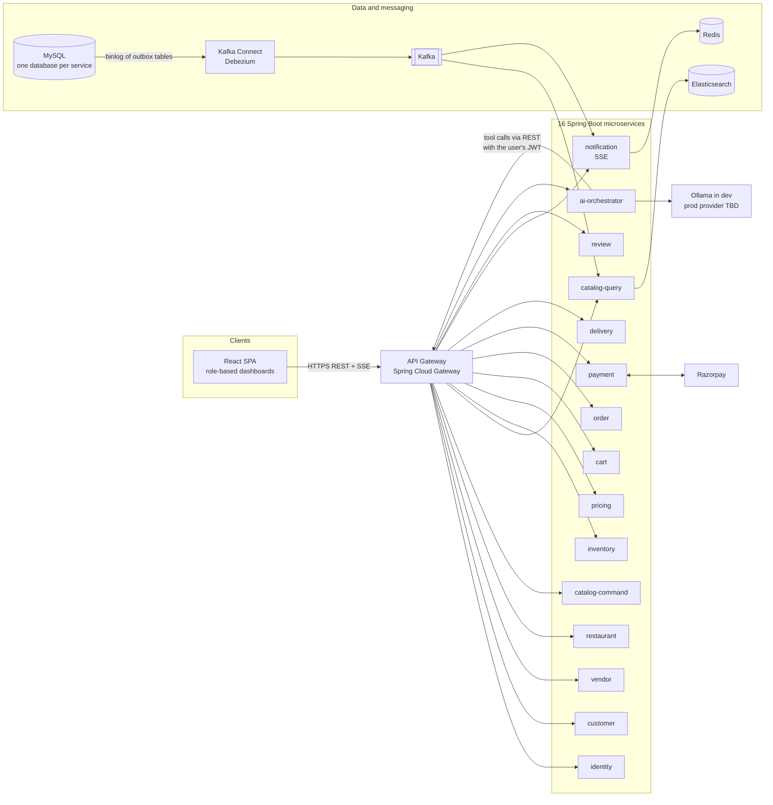

# 1. High-Level Architecture

## Diagram

## In plain language

- The customer, vendor, restaurant owner, delivery partner and admin all use **one React web app**.
  Each person sees only the dashboard for their role.
- Every request from the browser goes to the **API Gateway** first. The gateway checks who you are,
  limits abusive traffic and forwards the request to the right service.
- The backend is made of **16 small Spring Boot services**. Each one does one business job, such as orders,
  payments or delivery.
- Each service keeps its own data in **its own MySQL database**. No service reads another service's tables.
- When something important happens (an order is placed, stock changes), the service writes an **event** into
  an `outbox` table in the same database transaction. **Debezium** reads those rows from the MySQL binlog
  and publishes them to **Kafka**.
- Other services listen to Kafka and react. For example, the search service updates **Elasticsearch**,
  and the notification service pushes live updates to browsers.
- **Redis** holds fast, temporary data: carts, caches, rate limits, live delivery-partner locations and the
  messages that fan out real-time updates to every notification replica.
- The **AI orchestrator** talks to a language model (Ollama locally) and uses business services
  through normal REST APIs, with the same permissions as the logged-in user.
- **Razorpay** handles payments. Card data never touches our servers.

## Technology stack

| Layer | Technology | Why it is here |
|---|---|---|
| Frontend | React 19, TypeScript, Vite, Tailwind 4, React Router 7, TanStack Query 5 | One SPA with lazy-loaded role areas |
| Edge | Spring Cloud Gateway (2025.1.4) | Routing, JWT check, rate limit, CORS, correlation ID |
| Services | Java 25, Spring Boot 4.1.2, Spring MVC on virtual threads | Simple imperative code with high concurrency |
| Source of truth | MySQL 8.4.13 + Flyway | Transactions, constraints, mature tooling |
| Events | Kafka 4.3.2 (KRaft) + Debezium 3.7.1.Final | Reliable, ordered, replayable events |
| Search | Elasticsearch 9.4.6 | Fuzzy search, autocomplete, facets, geo |
| Fast state | Redis 8.8.4 | Cart, cache, rate limit, GEO, pub/sub, denylist |
| AI | Spring AI 2.0.2 + Ollama 0.40.15 (dev) | Provider-neutral agents and tool calling |
| Payments | Razorpay (test mode) | Orders API, Checkout, signed webhooks |

## Key rules

- MySQL is the source of truth for all transactional business data.
- Each service owns its database. Cross-service database access is never allowed.
- Events are published only through the transactional outbox and Debezium.
- Synchronous REST is used only when the user needs an immediate answer: login, search, quotes at checkout,
  and creating a payment session.
- The AI never touches a database directly and never has more rights than the user it acts for.
- Every service is independently buildable, testable and deployable.
