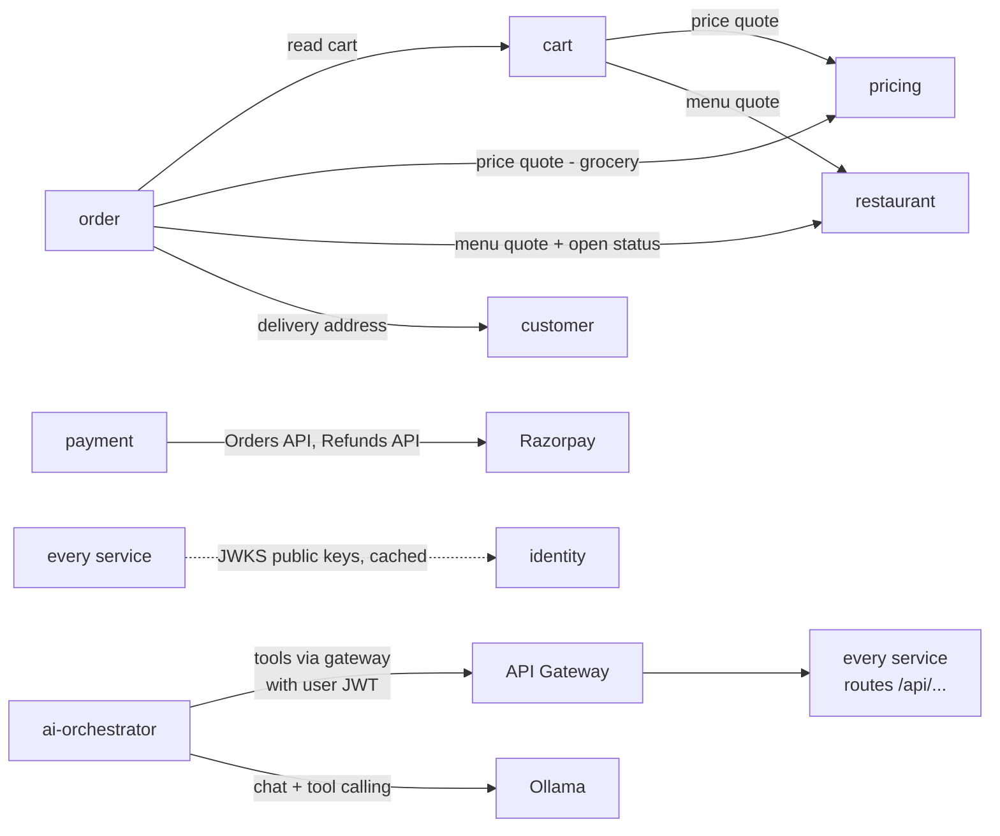
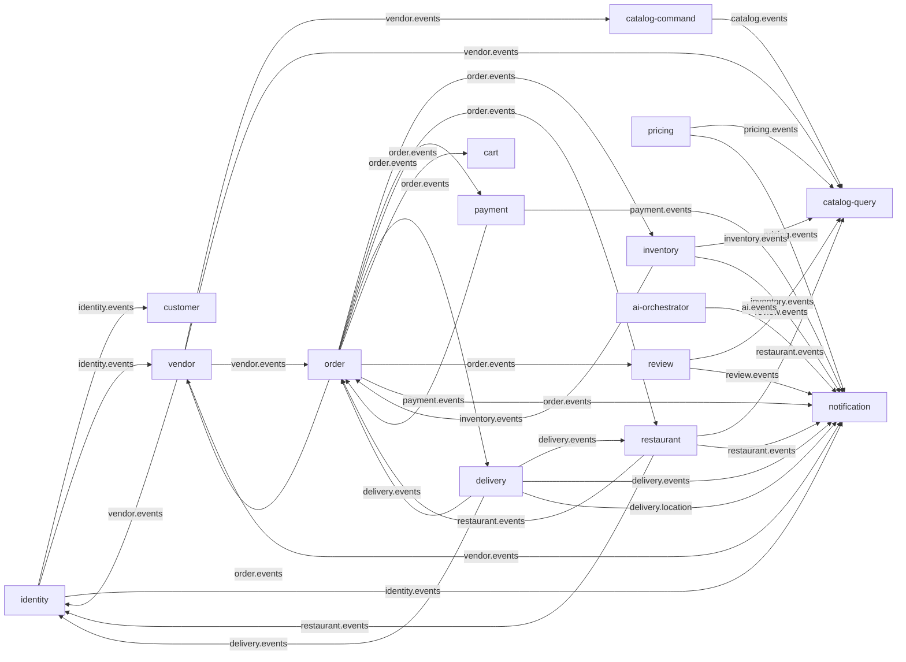

# 2. Microservices Interaction

## Synchronous calls (REST, only where an immediate answer is needed)

## Asynchronous collaboration (Kafka events)

## Interaction matrix

| Service | Calls synchronously | Publishes | Consumes |
|---|---|---|---|
| api-gateway | all services (routing) | — | — |
| identity | — | `identity.events` | vendor, restaurant, delivery approval and suspension events |
| customer | — | `customer.events` | `UserRegistered` |
| vendor | — | `vendor.events` | `UserRegistered`, `OrderConfirmed`, `OrderCancelled` |
| restaurant | — | `restaurant.events` | `OrderConfirmed`, `OrderCancelled`, `DeliveryPartnerAssigned` |
| catalog-command | — | `catalog.events` | `VendorSuspended` |
| catalog-query | — | — | catalog, pricing, inventory, vendor, restaurant, review events |
| inventory | — | `inventory.events` | `OrderCreated`, `OrderCancelled`, `OrderOutForDelivery` |
| pricing | — | `pricing.events` | — |
| cart | pricing, restaurant | — | `OrderCreated` |
| order | cart, pricing, restaurant, customer (at creation only) | `order.events` | inventory, payment, vendor, restaurant, delivery events |
| payment | Razorpay | `payment.events` | `OrderAwaitingPayment`, `OrderCancelled` |
| delivery | — | `delivery.events`, `delivery.location` | `OrderAccepted`, `OrderReadyForPickup`, `OrderCancelled` |
| notification | — | — | almost all topics |
| review | — | `review.events` | `OrderDelivered` |
| ai-orchestrator | business services through the gateway, Ollama | `ai.events` | — |

## In plain language

- Services talk to each other in two ways: **direct REST calls** and **events through Kafka**.
- REST calls are used only when someone is waiting for the answer. Example: when you press
  "Place order", the order service must check your cart and the current prices right away.
- Everything after the order is created happens through **events**. A service announces a fact
  ("stock reserved", "payment captured") and the interested services react on their own.
- Events make the system resilient. If the delivery service is down for a minute, its events wait in Kafka
  and are processed when it comes back.
- Every service validates JWTs itself, using public keys from the identity service. They are fetched once and cached.

## Key rules

- No service calls another service's database. Data is shared only through APIs or events.
- Every synchronous call has a timeout: connect 1 s, read 2–3 s. It runs behind a Resilience4j circuit breaker,
  and only idempotent reads are retried.
- A synchronous call must never be needed to finish a step that is already in progress through events.
- Events describe facts that already happened (past tense) and carry the stakeholder IDs needed by consumers.
- `delivery.location` is best-effort telemetry. It is not written through the outbox.
