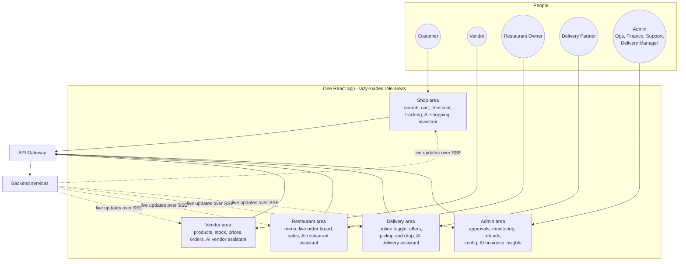
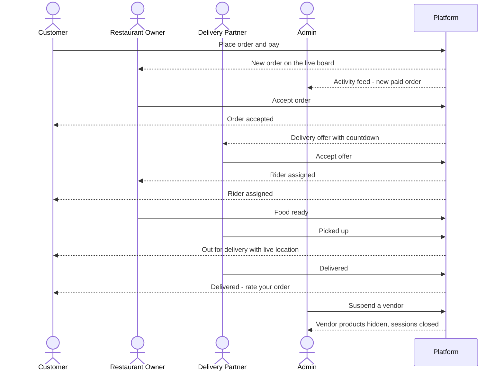

# 3. Stakeholder Interaction

## Who uses what

## How one stakeholder's action reaches the others

## Role capabilities

| Stakeholder | Main capabilities | Can see |
|---|---|---|
| Customer | Register, search, cart, checkout, pay, track, cancel, review, AI shopping assistant | Own profile, cart, orders, notifications |
| Vendor | Register (KYC), products, stock, prices, vendor orders, sales, AI vendor assistant | Own products, stock, prices, orders (`vendor_id` claim) |
| Restaurant owner | Register, profile, menu, availability, accept/reject/prepare orders, sales, AI assistant | Own restaurant, menu, orders (`restaurant_id` claim) |
| Delivery partner | Register, go online/offline, accept offers, pickup/deliver/fail, location, history, AI assistant | Own offers and deliveries (`partner_id` claim) |
| Admin (sub-roles) | Approvals, user/vendor/restaurant/partner management, categories, monitoring, refunds, config, AI insights | Everything, limited by sub-role for finance, ops and delivery actions |

## In plain language

- Everyone uses the **same web app**, but each person sees only their own area and their own data.
- Actions by one person often matter to others. A customer's payment creates a new order on the restaurant's
  screen. A rider accepting a job tells both the restaurant and the customer.
- These updates arrive **live**, without refreshing the page.
- The admin team sees an activity feed and can step in. They approve new sellers, issue refunds, reassign
  deliveries and suspend accounts.
- Each role also has an **AI assistant**. It can look things up freely, but anything that costs money or changes
  operations must be approved by a human.

## Key rules

- Authorization is decided by the backend, not the UI. Hidden buttons are a convenience, not a security control.
- Data ownership comes from JWT claims (`vendor_id`, `restaurant_id`, `partner_id`) and is checked in the service layer.
- Live updates go only to people allowed to see them. Nothing is broadcast to everyone.
- Admin powers are split into sub-roles: SUPER_ADMIN, OPS_ADMIN, FINANCE_ADMIN, SUPPORT, DELIVERY_MANAGER.
