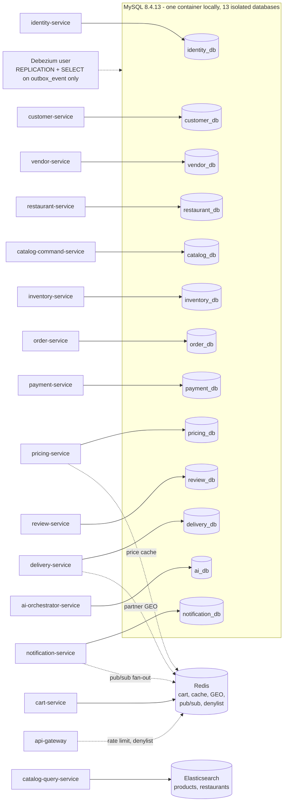

# 4. Database Ownership

## Diagram

## Main tables per database (grown phase by phase)

| Database | Owner | Main tables | Phase |
|---|---|---|---|
| identity_db | identity | user_account, role, user_role, refresh_token, stakeholder_link, login_audit | 1–2 |
| customer_db | customer | customer, address | 2 |
| vendor_db | vendor | vendor, vendor_document, vendor_status_history, vendor_order | 2, 8 |
| restaurant_db | restaurant | restaurant, opening_hours, restaurant_status_history, menu_category, menu_item, restaurant_order | 2, 3, 8 |
| catalog_db | catalog-command | category, brand, product, product_image, product_attribute | 3 |
| inventory_db | inventory | stock_item, stock_movement, stock_reservation | 4, 6 |
| pricing_db | pricing | product_price, price_history, price_change_request | 4 |
| order_db | order | customer_order, order_item, order_status_history, idempotency_key | 6 |
| payment_db | payment | payment, payment_attempt, refund, webhook_event | 6 |
| delivery_db | delivery | delivery_partner, partner_document, delivery, delivery_offer, delivery_status_history, partner_shift, location_sample | 2, 9 |
| notification_db | notification | notification, recipient_projection | 7 |
| review_db | review | review, review_eligibility, rating_summary | 12 |
| ai_db | ai-orchestrator | conversation, chat memory, ai_tool_invocation, approval_request, approval_decision | 11 |

Every MySQL database also has `outbox_event` and `processed_event` tables, created in `V1` by Flyway.

## In plain language

- Every service has **its own database** and is the only one allowed to touch it.
- On a laptop, all 13 databases live in **one MySQL Docker container** to save memory. Each service still has
  **its own database user**, which is allowed to see only its own database. A service cannot read another
  service's data even by mistake.
- The cart service keeps carts in **Redis**. A cart is temporary until checkout, and the order stores the final data.
- The search service keeps a **copy** of catalog data in **Elasticsearch**. It is a read-only view built from events.
- A special **Debezium** user can only read the binlog and the `outbox_event` tables. That is how events leave the database.
- In production the same databases start on one RDS instance. Busy or critical ones (order, payment, inventory)
  can later move to their own instances by changing only the connection string.

## Key rules

- No cross-service foreign keys. IDs from other services are plain columns.
- Primary keys are application-generated **UUIDv7** stored as `BINARY(16)`.
- Money is `DECIMAL(12,2)` in INR. All timestamps are UTC `DATETIME(6)`.
- `@Version` optimistic locking on product, price, order, payment, delivery and approval_request.
- Stock reservation uses an atomic conditional `UPDATE ... WHERE available >= ?` to prevent overselling.
- Schema changes go only through Flyway (`src/main/resources/db/migration`), and must stay backward compatible
  (expand, then contract).
- Pollers for deadlines use `SELECT ... FOR UPDATE SKIP LOCKED`, so multiple replicas never process the same row.
