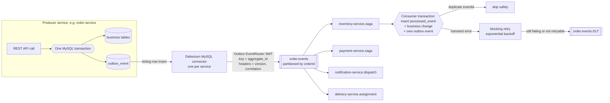
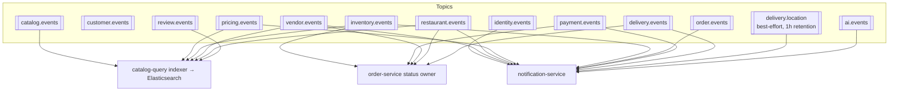

# 5. Kafka Event Flow

## From a business change to every interested service

## Topic map

The full list of events, producers and consumers is in the [event catalog](../events/event-catalog.md).

## In plain language

- A service never sends a business event to Kafka directly. It writes the event into its own
  **`outbox_event` table**, in the **same transaction** as the business change. Either both are saved or neither is.
- **Debezium** watches the MySQL binlog. When an outbox row appears, it publishes the event to the right
  Kafka topic. No events are lost, and no distributed transaction is needed.
- Each event is keyed by its **aggregate ID**, such as the order ID. All events about the same order land in the same
  partition and are read **in order**.
- Each consuming service reads with its own **consumer group**. Every interested service gets every event,
  but inside a service each event is processed by only one replica.
- Kafka can deliver an event twice. Consumers remember processed event IDs in `processed_event`, so a duplicate
  is simply skipped.
- If processing fails for a temporary reason, the consumer retries with growing delays. If it still fails, or the
  message is malformed, it moves to a **dead-letter topic** (`<topic>.DLT`) for inspection and replay.
  This way one bad message does not block the others.

## Key rules

- **Topics:** one per domain, named `<domain>.events`, plus `delivery.location` for telemetry.
- **Message key:** the aggregate ID. Partitions: 3 locally, 6–12 in production.
- **Production Kafka settings:** replication factor 3, `min.insync.replicas=2`, idempotent producers.
- **Headers:** `eventId`, `eventType`, `eventVersion`, `correlationId`, `causationId`, `occurredAt`.
- **Payloads are JSON.** Readers ignore unknown fields (tolerant reader). Additive changes keep the version number.
  A breaking change publishes a new version side by side until all consumers migrate.
- **Retries:** blocking retries on order-critical consumers, so ordering is preserved. Non-blocking retry topics are
  allowed only for notifications.
- **Cross-topic ordering is not guaranteed.** Consumers protect themselves with state-machine guards and compensate
  late events (e.g. a payment captured after cancellation is refunded).
- **Outbox cleanup:** rows older than 7 days are deleted by a scheduled job.
