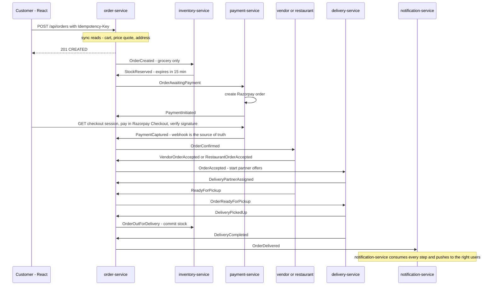
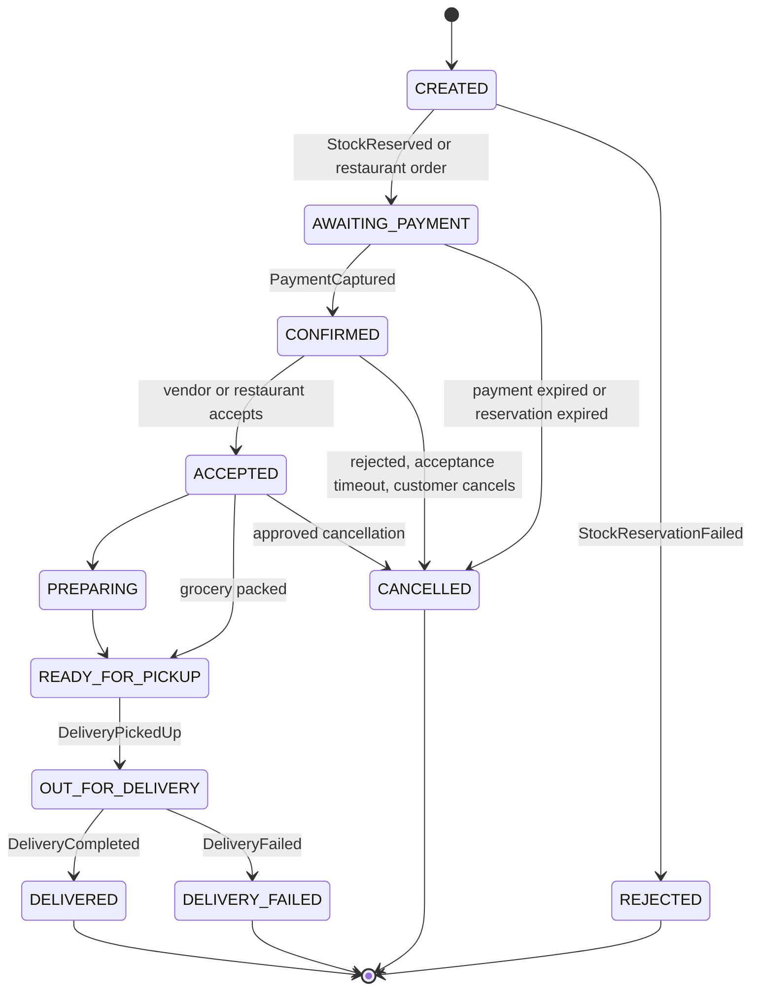
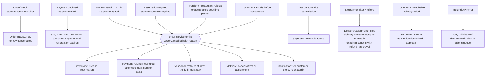

# 6. Order Saga Workflow (Choreography)

There is no central coordinator. **order-service owns the order status.** Every other service reacts to events and
owns its own timeouts. **`OrderCancelled` is the single trigger for compensation.**

## Happy path

**Restaurant orders** skip inventory. order-service checks menu availability and open status synchronously when
the order is created, then emits `OrderAwaitingPayment` right away.

## Order status

## Failures and compensation

## In plain language

- An order is a **chain of small steps**, each done by a different service. Each service finishes its step and
  announces it with an event. The next service picks it up from there.
- **order-service** keeps the official status of the order. It listens to every step and updates the status.
- Each service is responsible for its **own deadlines**:
  - inventory: reservation expiry
  - payment: payment window
  - restaurant and vendor: acceptance window
  - delivery: offer expiry
- When something goes wrong, order-service announces **`OrderCancelled`** with a reason. Every service then undoes
  its own part: stock is released, money is refunded, the rider is freed, and people are told.
- Events can arrive late or twice. Services check whether a change still makes sense before applying it. Example:
  if a payment arrives for an already cancelled order, it is refunded automatically.

## Key rules

- `POST /api/orders` requires an `Idempotency-Key`. Retries never create a second order.
- Webhooks, not the browser callback, are the final source of truth for payment status.
- Every status change is stored in `order_status_history` together with the causing event ID.
- Deadline pollers use `SELECT ... FOR UPDATE SKIP LOCKED`.
- Phase 10 adds a **stuck-order watchdog** and an **order timeline** to make choreography easy to debug.
  See [ADR-0004](../adr/0004-choreography-for-order-saga.md).
