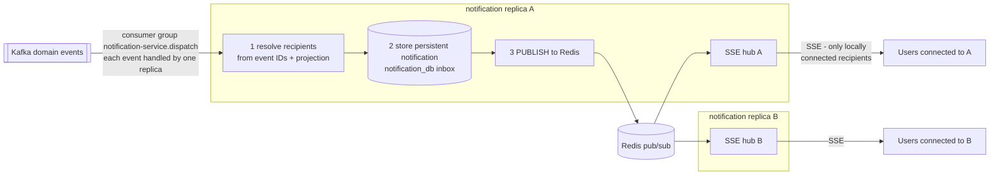
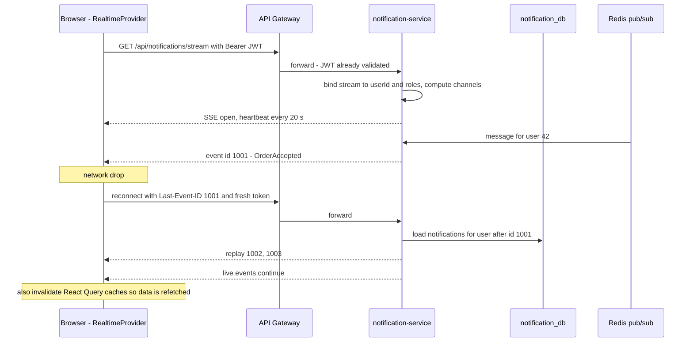

# 7. Real-Time Notification Architecture

## Multi-replica fan-out

## Connect, receive, reconnect

## Message kinds

| Kind | Examples | Stored? | On reconnect |
|---|---|---|---|
| Persistent notification | New order for restaurant, order accepted, approval requested, refund done | Yes, MySQL inbox (its ID is the SSE event ID) | Replayed using `Last-Event-ID` |
| Ephemeral live signal | Rider location, stock in/out, dashboard counters | No | Client refetches through React Query invalidation |

## Channels (always computed by the server)

| Channel | Who receives | Example |
|---|---|---|
| `user:{userId}` | One user, all their tabs | Customer's own order status |
| `role:ADMIN` | Connected admins (filtered by sub-role) | Activity feed, stuck orders, approvals |
| `public:catalog` | All connected shoppers, throttled | Product went out of stock |

## In plain language

- When something happens, the notification service decides **who** should know. It works this out from the IDs
  inside the event (customer, vendor, restaurant, rider) and a small local lookup table.
- Important messages are **saved first**, then sent. If your connection drops, you get the missed ones back when you reconnect.
- There can be several copies of the notification service. Your browser is connected to just one of them.
  **Redis pub/sub** passes every message to every copy, and each copy delivers it only to the users connected to it.
- Fast-changing data like a rider's position is **not saved**. If you miss some, the next update or a quick refetch
  fixes the screen.
- You can only receive what you are allowed to see. A vendor never receives another vendor's orders.

## Key rules

- **Transport is SSE.** Browser actions use normal REST.
- **The stream is authenticated with the JWT.** A fetch-based SSE client sends the `Authorization` header and `Last-Event-ID`.
- **Token expiry:** the server closes the stream when the token expires. The client reconnects with a fresh token
  and exponential backoff.
- **Server-side subscriptions only.** Clients never subscribe to arbitrary topics.
- **No broadcast of everything.** Stock is pushed only on in-stock ↔ out-of-stock transitions, and throttled.
- **Account suspension:** a suspended user's open stream gets a final "suspended" event and is closed.
