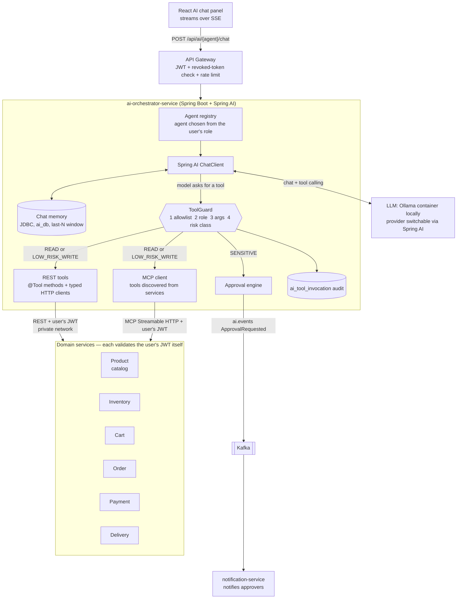

# 8. Agentic AI Architecture

## Components

Agreed flow: **User → API Gateway → Agent Orchestrator (Spring Boot + Spring AI) ← LLM (Ollama) → Tool calls (REST / MCP) → Product, Inventory, Cart, Order, Payment, Delivery**

### Tool transport: REST and MCP
| | REST tools (default) | MCP tools |
|---|---|---|
| Where the tool is defined | `@Tool` methods in ai-orchestrator calling the service's REST API | In the domain service itself (Spring AI MCP server, `/mcp`, Streamable HTTP) |
| Best for | All six domains in the MVP: typed, simple, easy to test | Tools a domain team owns and wants reusable by other MCP clients (pilot: product search, order status) |
| Security | User's JWT forwarded; service authorizes | Same JWT resource-server chain on `/mcp`; same ToolGuard in the orchestrator |
| Sensitive actions | Only `propose_*` tools → approval request | Same — never directly executable |

## The seven agents

| Agent | Used by | Automatic tools | Tools that require approval |
|---|---|---|---|
| Customer Shopping | Customer | search, compare, recommend, order status, add/remove cart items | place order, cancel order, request return |
| Payment | Customer | payment status and history, why a payment failed, time left to pay, refunds (with server-computed guidance) | cancel order |
| Customer Support | Customer | order tracking, order status, return status, raise and follow complaints | cancel order, request return |
| Vendor Management | Vendor | sales/inventory insights, restock suggestions, draft product text | stock changes, price changes (big changes also need admin) |
| Restaurant Operations | Restaurant owner | order queue summary, sales insights, prep suggestions | accept/reject exceptional orders, mark items unavailable |
| Delivery Operations | Delivery partner / manager | next-step guidance, history, earnings | reassignment (delivery manager) |
| Admin Business Intelligence | Admin | KPIs, trends, anomaly insights as structured output | refunds, suspensions, config changes; four-eyes above threshold |

## In plain language

- There is **one AI service** that hosts seven assistants. Your **role** decides which assistants you get (a customer has
  three and switches between them in the chat panel). The AI does not choose.
- The assistant can only do things through **tools**. A tool is a small piece of code that calls a normal business API.
- Every tool call goes through the **ToolGuard** first. It checks four things: whether this assistant may use the
  tool, whether you are allowed, whether the inputs are valid, and how risky the action is.
- Read-only and harmless actions run right away. Risky actions (money, prices, cancellations, suspensions) are
  **turned into an approval request** instead of being executed.
- Tools call the business services (product, inventory, cart, order, payment, delivery) **with your own login token**,
  either through their normal REST API or through an MCP endpoint the service publishes. Each service checks the token
  itself. The AI can never do more than you could do yourself.
- Conversations are remembered in the AI's own small database. The AI **never** reads business databases.
- Locally the model runs in an **Ollama container**. In production the assistants use **Claude** (Anthropic); Spring AI
  makes the provider a configuration switch (`AI_PROVIDER`).

## Key rules

- No uncontrolled autonomy. Each agent has a fixed tool allowlist, and there is no generic "call any API" tool.
- Tool arguments are validated against a schema and business limits before any call.
- Tool results (product descriptions, reviews) are treated as **untrusted data**, because of prompt injection.
  The backend enforces authorization anyway.
- Model output is rendered as sanitized markdown, never raw HTML.
- Each user has a rate limit and a token budget, and every LLM call has a timeout.
- If the LLM is down, the chat shows a fallback message. **Ordering never depends on AI.**
- Every tool call is audited: user, agent, tool, arguments, result summary, latency, status.
- Structured outputs (e.g. BI reports) use Spring AI `.entity(SomeRecord.class)`.

## As built (Phases 11 and 12)

- **Agents:** all seven agents are live:
  - **Customer Shopping** (`shopping`) and **Admin Business Intelligence** (`admin-bi`), since Phase 11;
  - **Vendor** (`vendor`), **Restaurant** (`restaurant`) and **Delivery** (`delivery`), added in Phase 12 on the same
    framework (an agent definition plus its tools);
  - **Payment** (`payment`) and **Customer Support** (`support`) for customers, with complaints in order-service —
    see [payment-and-support-agents.md](../api/payment-and-support-agents.md). Agents share tools where their jobs
    overlap (one implementation per tool).

  Phase 12 also added the approval actions ADJUST_STOCK, CHANGE_PRICE, SEND_PURCHASE_ORDER, SET_MENU_ITEM_AVAILABILITY,
  ACCEPT_STORE_ORDER, REJECT_STORE_ORDER, REASSIGN_DELIVERY and REQUEST_RETURN. Since then inventory-, pricing- and
  delivery-service check approval tokens too.
- **Tools:** REST tools that call the business APIs **through the gateway** with the user's JWT, and since 2026-11-20
  the **MCP pilot**: catalog-query-service publishes `searchProducts` (`POST /api/mcp/catalog`) and order-service
  publishes `getOrderStatus` (`POST /api/mcp/orders`) on Spring AI MCP servers (stateless Streamable HTTP, behind the
  same JWT check). The orchestrator's `McpGateway` is their MCP client, through the gateway, with each user's own
  token per call; ToolGuard and the audit (`transport` MCP or REST) apply unchanged, and an unreachable MCP server
  falls back to REST for that call. Contract: phase-11 §3 "MCP pilot".
- **Tool loop (Spring AI 2.0.2):** the loop runs in the ChatClient's tool-calling advisor, capped at 6 calls per
  message. Tool names the model invents, or takes from another agent, are blocked and audited, not errors.
- **Model providers:**
  - `ollama` (default `qwen3:4b-instruct`, a non-thinking model; thinking variants leak their reasoning into the
    answer) for development.
  - `scripted`, a deterministic rule-based stand-in, only in the local and docker profiles, for smoke tests and CI.
  - `anthropic`, **the production provider** (2026-11-20): Claude through Anthropic's Messages API (default
    `claude-opus-5-5`, `ANTHROPIC_MODEL`), key from Secrets Manager. The rules and tool definitions are cached on
    Anthropic's side; without a key the assistants answer AI_UNAVAILABLE without calling Anthropic.
- **Memory:** Spring AI's JDBC chat memory holds the last 20 messages for the model. A separate `ai_message` table
  keeps the full transcript shown to users.
- **Structured output:** admin insights use `.entity(InsightReport.class)`. If the model fails, the same data gives a
  rule-based report.
- Contract: [docs/api/phase-11-agentic-ai-and-approvals.md](../api/phase-11-agentic-ai-and-approvals.md).
