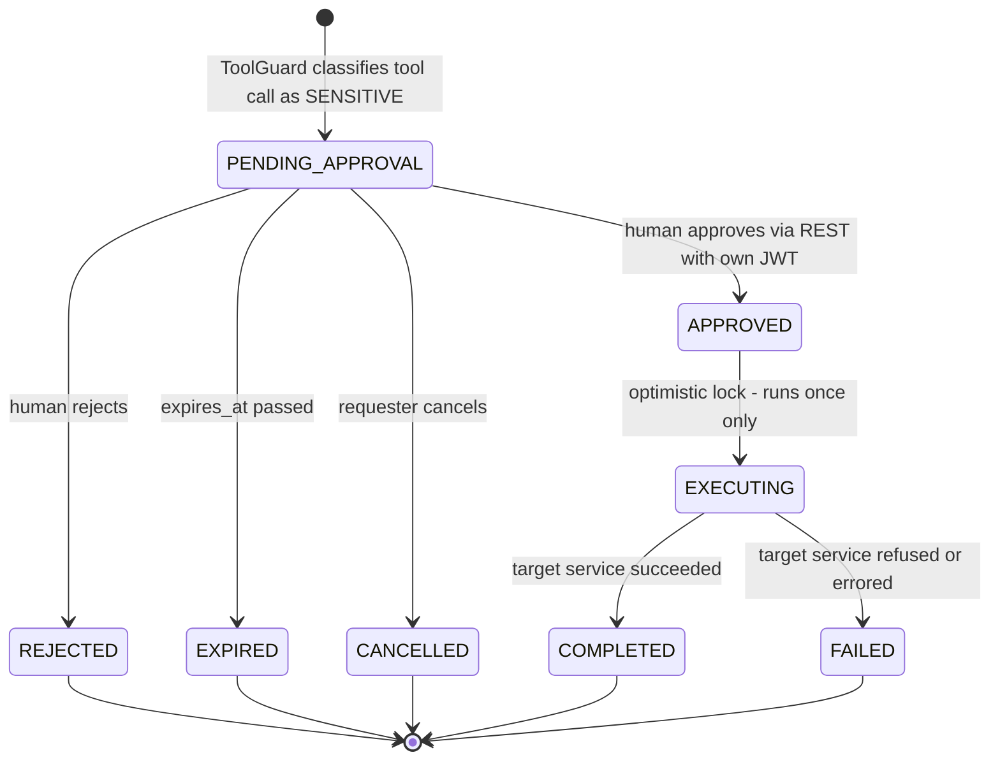
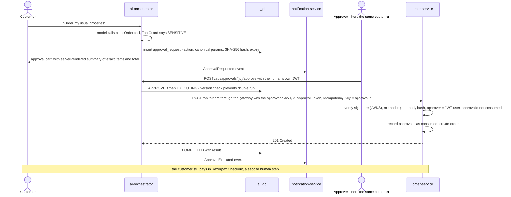

# 9. Human Approval Workflow

## Lifecycle

## From AI proposal to verified execution

## What the signed approval token contains

A JWS (RS256) signed by ai-orchestrator-service, valid for 60 seconds, sent as `X-Approval-Token`
([Phase 11 contract §5](../api/phase-11-agentic-ai-and-approvals.md#5-approval-token--verified-by-the-target-grocery-common-080)).

| Claim | Meaning |
|---|---|
| `jti` | The approval id; the target records it as used, and it is also the `Idempotency-Key` |
| `aud` | The one target service allowed to accept it |
| `act` | The action: `PLACE_ORDER`, `CANCEL_ORDER`, `REFUND_PAYMENT`, `ADMIN_CANCEL_ORDER`, `SUSPEND_VENDOR`, `SUSPEND_RESTAURANT` |
| `htm`, `htu` | The exact HTTP method and path |
| `bsh` | SHA-256 of the exact body, fixed when the AI proposed the action; the target recomputes it |
| `sub` | The human who approved; must be the user of the request's JWT |
| `obo` | The customer the action is for (customer actions) |
| `exp` | 60 seconds after signing |

## Who approves what

| Action | Approver |
|---|---|
| Place order, cancel order (via AI) — return requests later | The customer |
| Stock or price change (via AI) | The vendor; price change above threshold also needs an admin |
| Exceptional accept/reject, mark item unavailable (via AI) | The restaurant owner |
| Delivery reassignment | Delivery manager |
| Refund | Finance admin or super admin; a second person above ₹2,000 (four-eyes) |
| Admin order cancellation | Ops admin or super admin |
| Vendor or restaurant suspension | Ops admin or super admin, always a second person (four-eyes) |

## In plain language

- When the AI wants to do something important, it **does not do it**. It writes down exactly what it wants to do and asks a human.
- The person sees a clear summary built by the **server** from the exact parameters, not the AI's own wording.
  The AI's reasoning is shown separately.
- Only a **human** can approve, using their own login. The AI has no "approve" tool, so it can never approve itself.
- After approval, the action runs **once**. The service that does the work checks the approval token itself: the
  signature, the action, a fingerprint of the exact parameters, and that this approval was never used before.
  If anything was changed, it refuses.
- Everything is recorded: who asked, who approved, what exactly, when, and what happened.

## Key rules

- Approval is bound to the **exact action and parameters**, through the SHA-256 hash.
- **Backend services validate before executing.** A filter in `grocery-common` handles this on sensitive endpoints.
- **No duplicate execution:** optimistic locking on `approval_request`, plus a consumed-approval record at the target.
- Approvals expire if nobody acts in time.
- A double click is harmless: the second decision finds the approval no longer pending (409), and the target refuses a
  second use of the token.
- The action runs **with the approver's own rights** (their JWT), never with a privileged AI account.
- Rejected, expired and cancelled approvals can never be executed.

## As built (Phase 11)

- **Actions and deciders:** customer actions and the admin actions (refund, admin cancel, suspensions) work as in
  the tables above. The vendor, restaurant and delivery actions come with their assistants after the MVP.
- **Where the token is checked:** order-, payment-, vendor- and restaurant-service verify it with the grocery-common
  0.8.0 filter and record used approvals in `consumed_approval`.
- **Proved end to end** by `smoke-phase11.sh`: an approval whose stored amount was changed after the proposal is
  refused by payment-service with `APPROVAL_BODY_MISMATCH`.
