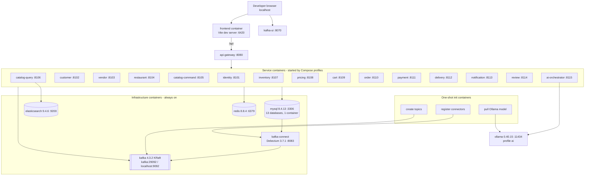
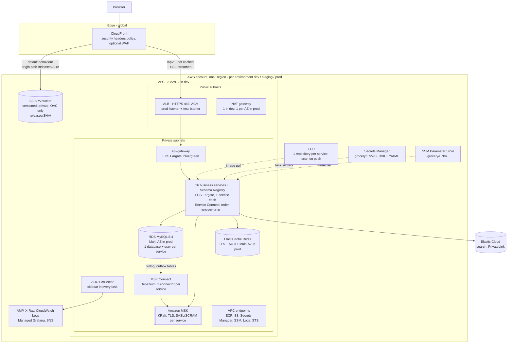
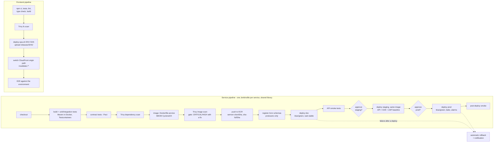
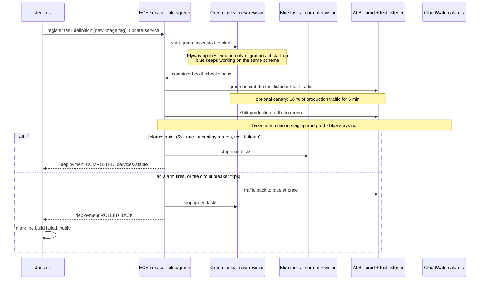
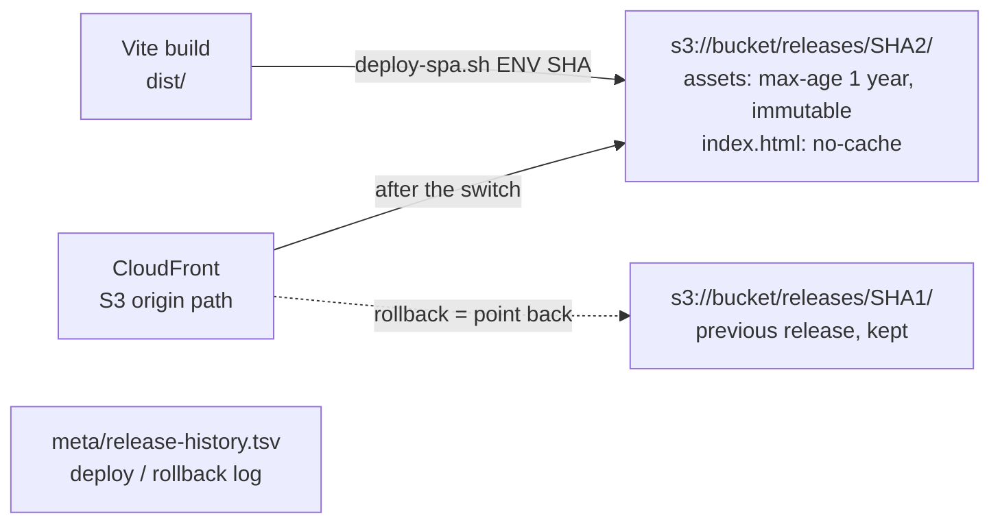
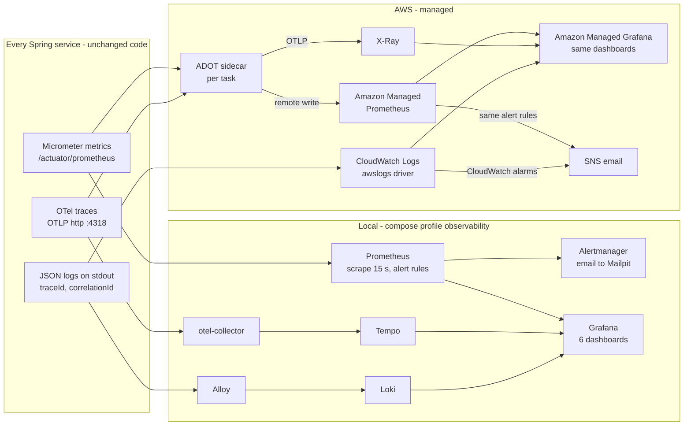

# 10. Deployment Architecture

## Now: local development fully in Docker Compose

### Compose profiles

| Profile | Starts |
|---|---|
| none (default) | mysql, kafka, kafka-connect, elasticsearch, redis, kafka-ui, init containers |
| `ai` | ollama + model pull |
| `identity`, `catalog`, `inventory`, `cart`, `orders`, `realtime`, `fulfillment`, `delivery`, `review` | The services for that phase, plus api-gateway |
| `frontend` | React dev server |
| `all` | Everything |

Example: `docker compose -f infrastructure/local/docker-compose.yml --profile identity --profile frontend up -d --build`

### Memory budget

| Group | Approximate memory |
|---|---|
| Infrastructure (MySQL 768 MB, Kafka 768 MB, Connect 768 MB, ES 1 GB, Redis 128 MB, Kafka UI 256 MB) | ≈ 3.5 GB |
| 16 service containers at 320–384 MB each | ≈ 5.5 GB |
| Ollama with a 3B–8B quantized model | 3–6 GB |
| Frontend dev server | ≈ 0.3 GB |
| **Everything at once** | **≈ 13–15 GB** inside the WSL2 VM |

## Production target: AWS (Phase 14)

Built and validated **offline**: Terraform, pipelines and images are checked locally, and nothing is applied to an AWS
account until the product owner does it. Contract: `docs/api/phase-14-cicd-and-aws.md`. Decisions: ADR-0012
(ECS Fargate), ADR-0013 (OpenTelemetry → AWS managed observability) and ADR-0014 (the path to Kubernetes).

### AWS deployment

| Concern | Service | Notes |
|---|---|---|
| Web app | S3 + CloudFront | Origin Access Control; the S3 origin path selects one release (`releases/<sha>/`); SPA fallback; response headers policy |
| API entry | CloudFront `/api/*` → ALB → `api-gateway` | Same origin as the SPA, so no CORS. ALB idle timeout and CloudFront origin timeout sized for SSE |
| Services | ECS Fargate, one service per deployable unit | Private subnets, Service Connect names, autoscaling on CPU and request count, ≥ 2 tasks in prod |
| Data | RDS MySQL, MSK + MSK Connect (Debezium), ElastiCache, Elastic Cloud | The same topology as locally: database per service, outbox → Debezium → Kafka, Avro + Schema Registry |
| Secrets / config | Secrets Manager, SSM, Spring profile `aws` | `application-aws.yml` reads environment variables only |
| One-off tasks | `db-init`, `kafka-init`, `schema-init` | The same scripts as the local init containers |

### Environments

| | dev | staging | prod |
|---|---|---|---|
| Availability zones | 2 | 3 | 3 |
| Tasks per service | 1 | like prod, smaller | ≥ 2 |
| RDS / Redis | single-AZ | Multi-AZ | Multi-AZ |
| NAT gateways | 1 | 1 per AZ | 1 per AZ |
| Blue/green bake time | none | 5 min | 5 min |
| How a deployment arrives | automatically after the build | manual approval | manual approval |

All three are composed from the same Terraform modules (`infrastructure/aws/terraform/envs/<env>`) with sizes from
tfvars. Names follow `grocery-<env>-<component>`; tags `Project`, `Environment`, `Service`, `ManagedBy=terraform`.

### CI/CD flow

- **One image, promoted.** The image built from a commit is the image that reaches prod: promotion re-tags it
  (`dev`, `staging`, `prod`) and never rebuilds.
- **Each service alone.** Every service has its own job, image, ECR repository, ECS service and Flyway history, so one
  can be built, deployed and rolled back without touching the others.
- **Libraries** (`libs/*`) have their own pipeline: build, schema compatibility gate, publish to CodeArtifact.
- **Locally**, Jenkins runs in Docker (`infrastructure/ci/jenkins/local/`) with a local registry standing in for ECR;
  the AWS stages run in `DRY_RUN` mode and print the exact `aws` calls.

### Blue/green deployment of one service

Internal services are shifted the same way through Service Connect. Manual rollback, during or after a deployment:
`infrastructure/ci/scripts/rollback.sh <env> <service> [<revision>]` (runbook: `docs/operations/deploy-and-rollback.md`).

### Web app releases on S3 + CloudFront

A release is immutable and complete before anyone sees it: files are uploaded under a new prefix, then the origin
path is switched in one distribution update and everything is invalidated. Rolling back is the same switch to an older
prefix, with no rebuild and no upload. The production nginx image (`frontend/grocery-web/Dockerfile.prod`) serves the
same build with the same headers for targets without CloudFront.

### Observability: local vs AWS

The services only know `OTEL_EXPORTER_OTLP_ENDPOINT` and their Prometheus endpoint, so the code is identical in both
places: only the collector behind them changes (ADR-0013). Trace sampling is 1.0 locally and 0.1 in AWS.

## In plain language

- On a laptop, **everything runs in Docker**. Nothing is installed as a Windows service. You only need Docker Desktop.
- All 13 databases share **one MySQL container** to save memory. They remain isolated by separate database users.
- **Profiles** let you start only what you are working on. Infrastructure always runs, and you add the profile for the
  current phase.
- Each Java service is built **inside Docker** with a multi-stage Dockerfile. You don't need Java or Maven installed
  to build or run the platform.
- **In AWS, the same containers run on ECS Fargate**: AWS runs them, with no servers or cluster to patch. MySQL,
  Kafka, Redis and search become managed services, so backups, failover and patching are AWS's (or Elastic's) job.
- **The website is just files** on S3, delivered by CloudFront close to the user. `/api` goes from the same address to
  the API gateway, so the browser sees one site.
- **A new version never replaces the old one in place.** ECS starts the new version next to the old one, moves the
  traffic, watches the alarms for five minutes, and only then stops the old one. If anything looks wrong, traffic goes
  back automatically. The website works the same way with release folders.
- **The pipeline is the only way into production.** It builds one image per commit, scans it, tests it in dev and
  staging, and a person approves each step towards prod.

## Key rules

- Every service is independently buildable (`docker compose up -d --build <service>`), deployable and rollbackable:
  its own pipeline, image, ECR repository, ECS service and Flyway migrations.
- **Spring profiles:** `docker` for container hostnames, `local` for running one service from the IDE against the
  containerized infrastructure, `aws` for ECS (environment variables only, no secrets in files).
- Containers have memory limits. JVMs use `-XX:MaxRAMPercentage=75 -XX:+UseSerialGC -XX:TieredStopAtLevel=1 -Xss512k`
  locally; ECS task sizes come from `services.auto.tfvars.json`.
- Elasticsearch security is off **only locally**. Elastic Cloud uses an API key from Secrets Manager over PrivateLink.
- Secrets are in a git-ignored `.env` locally (with a committed `.env.example` that never holds real values), and in
  AWS Secrets Manager (`grocery/<env>/<service>/<name>`), injected as ECS task secrets.
- **Migrations are expand/contract.** Flyway runs at start-up, and during blue/green the old and the new version share
  the schema, so a migration must never break the previous release. Destructive changes ship in a later "contract"
  release. Migrations are never rolled back.
- **Schemas before producers:** the pipeline registers Avro schemas (`BACKWARD_TRANSITIVE`) before a producer deploys.
- **Images are immutable and promoted, never rebuilt;** tags are `<semver>-<shortSha>` and `sha-<fullSha>`.
- **Streams through every hop:** CloudFront does not cache or compress `/api/*`; the ALB idle timeout and the
  CloudFront origin response timeout must exceed the longest silence on an SSE stream (the notification stream sends a
  heartbeat every 20 s; an AI chat can wait for the model, so use ≥ 60 s at CloudFront and ≥ 120 s at the ALB).
- **The gateway sees two proxies in AWS** (CloudFront, then the ALB): the client IP for rate limiting is the
  second-to-last `X-Forwarded-For` entry there, not the last one as behind a single proxy.
- **The public origin must be allowed by the gateway's CORS check** (`grocery.gateway.allowed-origins`, env
  `GROCERY_GATEWAY_ALLOWED_ORIGINS`, default `http://localhost:6420`). The browser sends `Origin` on every POST. When
  the `Host` the gateway receives differs from that origin (CloudFront → ALB rewrites it), Spring treats the call as
  cross-origin and answers 403. Set it to `https://<site domain>` per environment. The nginx image avoids this by
  forwarding the browser's `Host`.
- **Security headers are defined twice and must match:** the CloudFront response headers policy and the nginx image
  (`frontend/grocery-web/nginx/templates/security-headers.inc.template`). CloudFront also adds
  `upgrade-insecure-requests` and HSTS.
