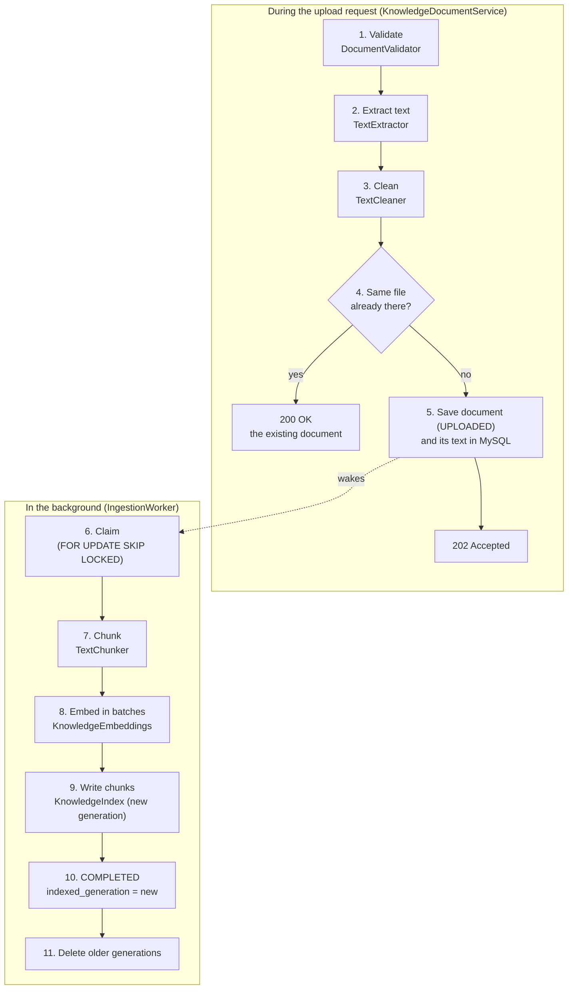
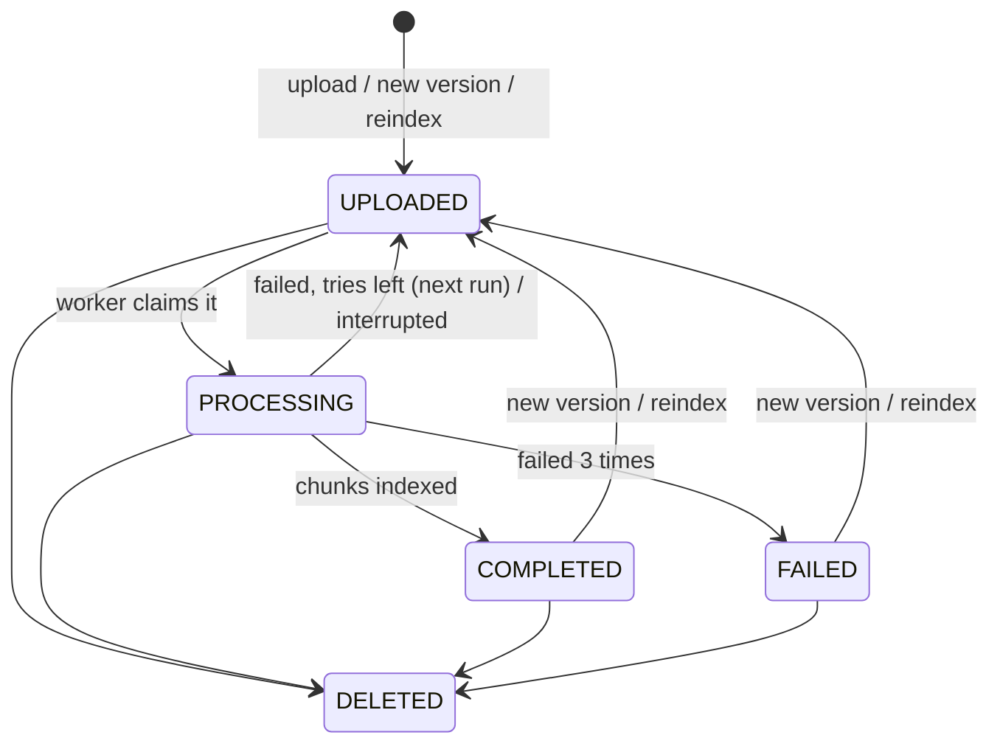

# Knowledge base (RAG) — document ingestion

How an uploaded help-center document becomes searchable passages. Code: `services/ai-orchestrator-service/src/main/java/com/grocery/ai/knowledge/`.

## 1. The pipeline



Steps 1–5 run in the request, so a bad file is refused at once with a clear error. Steps 6–11 can take a while
(embedding on a CPU), so they run in the background and the upload answers **202 Accepted** immediately. The admin page
refreshes itself while a document is waiting or indexing.

## 2. Validation (`DocumentValidator`)

| Check | Rule | Error |
|---|---|---|
| Not empty | at least one byte | 400 `EMPTY_DOCUMENT` |
| Size | ≤ `upload.max-file-size` (5 MB; the web app's nginx accepts 5 MB) | 413 `DOCUMENT_TOO_LARGE` |
| Extension | `.pdf` `.docx` `.txt` `.md` `.markdown` `.html` `.htm` | 415 `UNSUPPORTED_DOCUMENT_TYPE` |
| Content matches the extension | PDF starts with `%PDF-`; DOCX is a ZIP with `word/document.xml`; text formats are valid UTF-8 without NUL bytes | 400 `INVALID_DOCUMENT` |
| No macros | a `.docx` with `vbaProject.bin` (a renamed `.docm`) is refused | 400 `INVALID_DOCUMENT` |
| ZIP bomb | at most 1,000 entries; `word/document.xml` at most 30 MB unpacked | 400 `INVALID_DOCUMENT` |

## 3. Extraction (`TextExtractor`)

| Format | How |
|---|---|
| PDF | Spring AI `PagePdfDocumentReader` (PDFBox), page by page. A **scanned PDF has no text**: run text recognition (OCR) first, otherwise `EMPTY_DOCUMENT`. Password-protected PDFs are refused. |
| DOCX | The paragraphs of `word/document.xml`, read with a safe XML parser (no DTDs, no external entities). No Office library is needed. |
| HTML | Spring AI `JsoupDocumentReader`: headings, paragraphs, list items, table cells; scripts and styles are never read. |
| TXT, Markdown | The text itself (UTF-8, byte-order mark removed). Markdown headings stay: they help the chunks. |

## 4. Cleaning (`TextCleaner`)

One Unicode form (NFC), `\n` line ends, no control or zero-width characters, a word split by a hyphen at a line end
joined again ("deli-\nvery" → "delivery"), single spaces, trimmed lines, at most one blank line between paragraphs. The
text is then at most `upload.max-text-characters` (300,000), otherwise `DOCUMENT_TOO_LONG`.

## 5. Duplicates and versions

- The **SHA-256 of the file** is stored. Uploading a file that is already in the knowledge base (any name) creates
  nothing and embeds nothing: **200 OK** with the existing document.
- **A new version** (`PUT /documents/{id}` with a new file): `content_version` + 1, a new generation is indexed, and
  the **previous version stays in use** until the new one is complete.
- **The same file with new details** (title, category, audiences): indexed again, because these are stored with every
  chunk. **The same file and details:** 200, nothing happens.
- **Reindex** (`POST /documents/{id}/reindex`): a new generation from the stored text, e.g. after changing the chunk
  size or the embedding model.

## 6. Chunking (`TextChunker`)

```
paragraphs (blank lines)
   └─ a paragraph longer than a chunk → sentences (. ! ? and the Devanagari danda)
         └─ a sentence longer than a chunk → words
packed in order up to chunk-tokens × 4 characters
each chunk after the first starts with the last sentences of the previous one (≈ overlap-tokens)
```

Example with 20-token chunks (80 characters) and 5-token overlap (20 characters):

```
"Orders below the minimum are refused. Delivery is free above a limit.

 Cancellations are possible until the store accepts the order."

chunk 1: "Orders below the minimum are refused. Delivery is free above a limit."
chunk 2: "above a limit.

          Cancellations are possible until the store accepts the order."
```

Tokens are estimated as 4 characters (English prose). The defaults (350 / 50) fit the local model's 8,192-token window;
see [RAG-ARCHITECTURE.md §9](RAG-ARCHITECTURE.md#9-configuration-at-a-glance).

## 7. Embedding (`KnowledgeEmbeddings`)

- Each chunk is embedded as `document-prefix + title + "\n\n" + chunk` (the title gives a short chunk its context;
  `nomic-embed-text` is trained with the prefixes `search_document: ` and `search_query: `; Titan uses none).
- `batch-size` (16) chunks per call. **Before each batch the worker waits while a customer's chat uses the model**
  (`ModelActivity`, at most 2 minutes), so indexing never slows a customer down on the shared local Ollama.
- Every vector must have exactly `embedding.dimensions` numbers; another model fails the document with a clear message
  instead of writing vectors the index cannot hold.

## 8. The index (`KnowledgeIndex`, `src/main/resources/elasticsearch/knowledge.json`)

One Elasticsearch document per chunk:

| Field | Type | Used for |
|---|---|---|
| `chunkId` | keyword | the id (also `knowledge_chunk.id` in MySQL) |
| `documentId`, `generation`, `chunkIndex` | keyword / integer | deleting versions, checking hits |
| `title`, `text` | text | what the model is given |
| `category`, `audiences` | keyword | exact filters |
| `embedding` | `dense_vector`, `hnsw`, cosine | kNN search |

Alias `grocery-knowledge` over `grocery-knowledge_v1` (`index-version`). The index is created at startup when
Elasticsearch answers, otherwise before the first write; startup never fails because of it.

## 9. Statuses and failures



| What the admin sees (`failureReason`) | Cause | Fix |
|---|---|---|
| The embedding model is not installed (local: ollama pull &lt;model&gt;). | Ollama has no `nomic-embed-text` | `docker exec grocery-ollama-1 ollama pull nomic-embed-text`, then Reindex |
| The embedding model could not be reached. | Ollama / Bedrock down or blocked | Start it; the document is retried automatically |
| Elasticsearch could not be reached or refused the chunks. | Elasticsearch down, or the API key lacks rights | See [troubleshooting](RAG-TROUBLESHOOTING.md) |
| The embedding model … returns vectors of N numbers, but the index expects M | A different model than the index was built for | Set `embedding.dimensions` and a new `index-version`, then reindex |
| Indexing was interrupted too often. | The replica kept stopping mid-way | Check the service's memory and logs, then Reindex |

**Delete** marks the document `DELETED` in MySQL (unsearchable at once) and removes its chunks from the index; if that
removal fails, every worker run tries again. **Two replicas** never index the same document (the claim uses
`FOR UPDATE SKIP LOCKED`); a replica that stops mid-way leaves the document `PROCESSING`, and after
`ingestion.processing-timeout` (10 minutes) it is tried again.

## 10. Writing good articles

- **One topic per article**, a clear title ("Cancellations and refunds"), short paragraphs that each make sense on
  their own (each may be retrieved alone), headings for sections.
- **Write the rule in words, not the admin-set numbers.** The minimum order, delivery fees, free-delivery amount,
  return window, acceptance and review windows are platform settings that admins change; the assistant reads the
  current amounts with `getStoreRules` or from the order. An article that says "₹99" goes stale the day an admin
  changes it.
- **Say what the app does not do** ("The app has no cash on delivery"): otherwise the model may assume it does.
- **Choose the readers** carefully: a vendor guide for `VENDOR`, `RESTAURANT_OWNER`, `STAFF` only.
- Test with **Admin → Help center → Test the search** before relying on it.

The starter articles in `src/main/resources/knowledge/seed/` follow these rules; they are loaded into an empty
knowledge base when `AI_KNOWLEDGE_SEED=true` (Docker and host-run do this). Once anything was uploaded or deleted, they
are never loaded again, so admins' changes stay.
