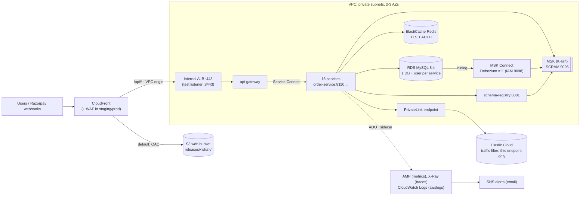

# AWS infrastructure (Phase 14)

Terraform for running the grocery platform on AWS, as specified in
[docs/api/phase-14-cicd-and-aws.md](../../docs/api/phase-14-cicd-and-aws.md).

> **Status: built and validated offline only.** Nothing here has been applied to an AWS account, and no credentials
> are needed to validate it. Applying it is a later action for the owner (see [How to apply](#how-to-apply-owner)).

## Contents

| Path | What it is |
|---|---|
| `terraform/bootstrap/` | S3 state bucket (versioned, SSE-KMS, TLS only, access-logged), DynamoDB lock table, KMS key `alias/grocery-tfstate`. Applied once per account, with local state. |
| `terraform/envs/shared/` | Account-level resources shared by all environments: ECR repositories, the CodeArtifact Maven repository, and the CI build role `grocery-ci`. |
| `terraform/envs/{dev,staging,prod}/` | One root per environment. `main.tf`, `variables.tf`, `outputs.tf`, `versions.tf` and `plan.tftest.hcl` are **identical** (validate.sh checks this). Only `<env>.tfvars` and `backend.tf` differ. |
| `terraform/services.auto.tfvars.json` | The **single definition of the 19 deployable units**: 17 Spring Boot services, the Confluent Schema Registry and the web SPA. It also holds the one-off tasks and the Kafka topics. Derived from `infrastructure/local/docker-compose.yml`. |
| `terraform/modules/platform/` | Composes one environment from the modules below (so the three env roots stay identical). |
| `terraform/modules/*` | `network`, `ecr`, `codeartifact`, `ecs-cluster`, `ecs-service`, `alb`, `rds-mysql`, `msk`, `msk-connect`, `elasticache`, `elastic-cloud`, `spa-hosting`, `secrets`, `observability`, `one-off-task` |
| `validate.sh` | Offline validation in Docker: fmt, validate, mock-provider plan tests, tflint, Trivy, observability configs. |
| `.tflint.hcl`, `.trivyignore`, `terraform/envs/dev/.trivyignore` | Linter config and **accepted** findings, each with its reason. |

**Versions:** Terraform `>= 1.10` (validated with 1.17.2), `hashicorp/aws ~> 6.73` (6.73.0), `elastic/ec ~> 0.14.0`
(0.14.0), `hashicorp/random` 3.9.x and `hashicorp/tls` 4.4.x (through the secrets module). The
`.terraform.lock.hcl` files pin the exact provider builds.

## Architecture



- **There is no public load balancer.** CloudFront is the only public entry point. It serves the SPA from S3 and sends
  `/api/*` to an **internal** ALB through a CloudFront VPC origin. The ALB security group only admits CloudFront's
  origin-facing prefix list on 443.
- **ECS Fargate:** cluster `grocery-<env>-cluster`, with one ECS service per unit in private subnets.
  - **Service Connect** gives every unit the same name and port as in compose (`http://order-service:8110`), so the
    service URLs in the catalog are the compose ones.
  - Platform `X86_64` by default (`cpu_architecture` switches to `ARM64`).
  - Dev runs on Fargate Spot.
- **Task = app container `app` + ADOT sidecar `adot-collector`:**
  - The sidecar scrapes `/actuator/prometheus` (the app port, or `metrics_port` = the gateway's management port 9080) every 15 s (job `services`, plus a `task_id` label) and remote-writes
    to AMP.
  - It receives OTLP traces on `localhost:4318` and sends them to X-Ray.
  - Both containers log JSON to `/grocery/<env>/<unit>` through the awslogs driver.
  - The collector config is one SSM parameter, `/grocery/<env>/adot/collector-config`.
- **Least privilege:**
  - The execution role can pull only its own ECR repository and read exactly the secrets and parameters it injects;
    KMS decrypt is limited to calls through Secrets Manager and SSM.
  - The task role grants only `aps:RemoteWrite` on one workspace and X-Ray put (plus ECS Exec in dev). It explicitly
    denies IAM, Organizations and AssumeRole.
  - One-off tasks get a deny-all task role.
- **Network:** public subnets hold only the NAT gateways (one in dev, one per AZ otherwise). VPC endpoints: S3
  (gateway), ECR API/DKR, Secrets Manager, SSM, CloudWatch Logs, STS. Flow logs are on, and the default security group
  is emptied.
- **Data:**
  - **RDS for MySQL 8.4:** Multi-AZ in staging/prod. Debezium parameter group (`binlog_format=ROW`,
    `binlog_row_image=FULL`, GTID on), TLS required, master password managed by RDS. Binlog retention of 72 h is set
    by `db-init` with `mysql.rds_set_configuration`, because it is not a parameter on RDS.
  - **MSK:** KRaft, TLS in transit, SCRAM for the services and IAM for MSK Connect, KMS at rest.
  - **ElastiCache Redis 7.1:** TLS required, AUTH token, KMS, Multi-AZ when there is more than one node,
    `volatile-lru` eviction as locally.
  - **Elastic Cloud 9.4.6:** reachable through PrivateLink only.

### Blue/green: native ECS (no CodeDeploy)

AWS provider 6.x supports ECS's native blue/green on `aws_ecs_service`: `deployment_controller { type = "ECS" }`,
`deployment_configuration { strategy = "BLUE_GREEN" | "CANARY", bake_time_in_minutes, canary_configuration }`,
`load_balancer.advanced_configuration` (alternate target group and production/test listener rules) and Service
Connect `test_traffic_rules`. So CodeDeploy is not used.

- **api-gateway** and **schema-registry** are load balanced. Each has two target groups (`grocery-<env>-ag-blue|green`,
  `...-sr-blue|green`), a production listener rule and a test listener rule. ECS re-weights the rules through the role
  `grocery-<env>-ecs-infra-lb`:
  - gateway: production 443, test 8443;
  - Schema Registry: production 8081, test 18081.
  - The test listeners admit only `operator_cidrs` (CI agents / VPN).
- **Internal services** shift traffic through Service Connect.
- **Bake time** is 5 min in staging and prod, 1 min in dev.
- **Canary** is optional per unit: `service_overrides = { "<unit>" = { canary_percent = 10 } }`. It shifts 10 % for
  `canary_bake_minutes` (5), then 100 %. prod enables it for the gateway as the example.
- **Automatic rollback** comes from the deployment circuit breaker plus these CloudWatch alarms on the service:
  - `grocery-<env>-<unit>-5xx-rate`: more than 5 % 5xx with at least 20 requests per minute. Load-balanced units
    measure ALB target 5xx over both target groups; internal units use the Service Connect metrics.
  - `grocery-<env>-<unit>-task-failures`: from an EventBridge rule on STOPPED tasks
    (`TaskFailedToStart` / `EssentialContainerExited`) and a log metric filter.
  - `grocery-<env>-<unit>-unhealthy-targets` (load-balanced units only).
- **CI owns deployments.** Terraform creates the first task definition revision and ignores the service's
  `task_definition`, `desired_count` (autoscaling) and `load_balancer` (ECS swaps the target groups after each
  deployment). Task definitions use `skip_destroy`, so old revisions stay available for `rollback.sh`.
  - The image tag each unit runs lives in SSM: `/grocery/<env>/<unit>/image-tag`. CI writes it, and Terraform reads
    it. When an apply registers a new revision (for example after an environment-variable change), it keeps the
    deployed image.
  - An infrastructure-only change reaches the running tasks at the next CI deployment or with
    `aws ecs update-service --cluster grocery-<env>-cluster --service grocery-<env>-<unit> --task-definition grocery-<env>-<unit>`
    (that uses the latest revision).

### Deploy contract (what CI must use)

The complete map is in the env output `deploy_contract` and in SSM `/grocery/<env>/deploy/contract` (JSON).

| Item | Name |
|---|---|
| ECR repository (shared by all envs) | `grocery/<unit>`, e.g. `grocery/order-service`, plus `grocery/grocery-web` (nginx image) and `grocery/schema-init`. Tags are immutable except `dev`, `staging`, `prod`. Scan on push is on. Lifecycle: keep 30 tagged images, expire untagged after 7 days. |
| ECS cluster | `grocery-<env>-cluster` |
| ECS service | `grocery-<env>-<unit>`, e.g. `grocery-dev-order-service` |
| Task definition family | the same as the service name |
| Container to re-image | `app` (the sidecar is `adot-collector`) |
| Image tag record | SSM `/grocery/<env>/<unit>/image-tag` (String). Write it after a successful deployment. |
| Deploy role | `grocery-<env>-deployer`, created when `ci_principal_arns` is set |
| Build/push role | `grocery-ci` (envs/shared): ECR push and CodeArtifact publish |
| One-off tasks | families `grocery-<env>-db-init`, `grocery-<env>-kafka-init`, `grocery-<env>-schema-init` |
| SPA | SSM `/grocery/<env>/frontend/bucket-name` and `/grocery/<env>/frontend/distribution-id`. The bucket holds `releases/<sha>/`; `deploy-spa.sh` switches the S3 origin path, and Terraform ignores origin changes. |
| Logs | `/grocery/<env>/<unit>` (prefixes `app/`, `adot/`, `service-connect/`) |

The deploy role covers what deployments and rollbacks need:

- ECS: `RegisterTaskDefinition`, `DescribeTaskDefinition`, `UpdateService`/`DescribeServices` on this cluster,
  `List`/`DescribeServiceDeployments`, `StopServiceDeployment` (rollback), and `RunTask` for `grocery-<env>-*` families;
- `iam:PassRole` on `grocery-<env>-*` roles, only to `ecs-tasks`;
- SSM get/put under `/grocery/<env>/`;
- S3 `releases/*` and `meta/*` on the web bucket, plus its KMS key;
- CloudFront get, update and invalidate on the distribution;
- describe calls on ALB target health and CloudWatch alarms, and reading the `/grocery/<env>/*` logs.

A deployment is: build and push `grocery/<unit>:<semver>-<shortSha>`, then
1. `aws ecs describe-task-definition --task-definition grocery-<env>-<unit>` (the latest revision);
2. replace the image of container `app`, then `register-task-definition`;
3. `aws ecs update-service --cluster grocery-<env>-cluster --service grocery-<env>-<unit> --task-definition <new arn>`;
4. `aws ecs wait services-stable` (blue/green, bake, alarms);
5. `aws ssm put-parameter --name /grocery/<env>/<unit>/image-tag --value <tag> --overwrite`.

### What the services receive (contract §7, for `application-aws.yml`)

Every Spring service gets:

- `SPRING_PROFILES_ACTIVE=aws`, `GROCERY_ENV`, `TZ=UTC`, `JAVA_TOOL_OPTIONS`;
- `OTEL_EXPORTER_OTLP_ENDPOINT=http://localhost:4318` and `TRACING_SAMPLING_PROBABILITY` (0.1 by default, 1.0 in
  dev);
- `JWT_ISSUER=https://<domain>` and `IDENTITY_JWKS_URI=http://identity-service:8101/.well-known/jwks.json`.

Then, according to the unit's `needs`:

| Need | Variables | Notes |
|---|---|---|
| database | `DB_HOST`, `DB_PORT`, `DB_USERNAME`/`DB_PASSWORD` (secret) | RDS requires TLS: the aws profile must use `sslMode=REQUIRED`, not the docker profile's `useSSL=false`. |
| kafka | `KAFKA_BOOTSTRAP_SERVERS` (SCRAM brokers, port 9096), `KAFKA_SASL_USERNAME`/`KAFKA_SASL_PASSWORD` (secret) | `security.protocol=SASL_SSL`, `sasl.mechanism=SCRAM-SHA-512` |
| schema registry | `SCHEMA_REGISTRY_URL` = `GROCERY_EVENTS_AVRO_SCHEMA_REGISTRY_URL` = `http://schema-registry:8081` | |
| redis | `REDIS_HOST`, `REDIS_PORT`, `REDIS_TLS=true`, `REDIS_AUTH` (secret) | |
| elasticsearch | `ELASTICSEARCH_URIS` (PrivateLink URL), `ELASTICSEARCH_API_KEY` (secret) | |
| approval tokens | `APPROVAL_JWKS_URI=http://ai-orchestrator-service:8115/.well-known/approval-jwks.json` | |

The unit-specific values (timeouts, windows) are the compose defaults, listed in the catalog. `ai-orchestrator-service`
gets `AI_PROVIDER` (default `ollama`) and `OLLAMA_BASE_URL` only when `ollama_base_url` is set; with no endpoint the
assistant answers `AI_UNAVAILABLE`. `notification-service` uses SES SMTP: `GROCERY_MAIL_ENABLED=false` until the SMTP
secret is filled.

### Secrets and parameters

| Secrets Manager name | Content | Source |
|---|---|---|
| `grocery/<env>/<unit>/db` | `{"username","password"}` | generated; db-init creates the MySQL user |
| `grocery/<env>/debezium/db` | `{"username","password"}` | generated; read by MSK Connect through the config provider |
| `AmazonMSK_grocery/<env>/<unit>/kafka` (also `kafka-admin`) | `{"username","password"}` | generated; MSK requires the `AmazonMSK_` prefix and a customer-managed key |
| `grocery/<env>/redis/auth-token` | `{"auth_token"}` | generated |
| `grocery/<env>/identity-service/bootstrap-admin` | `{"password"}` | generated (the e-mail comes from `bootstrap_admin_email`) |
| `grocery/<env>/ai-orchestrator-service/approval-signing-key` | RSA 2048 PKCS#8 PEM | generated (`tls_private_key`); the same key for every replica |
| `grocery/<env>/schema-registry/kafkastore-jaas` | `{"jaas_config"}` | derived from the registry's SCRAM user |
| `grocery/<env>/payment-service/razorpay` | `{"key_id","key_secret","webhook_secret"}` | **placeholder: set it** |
| `grocery/<env>/catalog-query-service/elasticsearch` | `{"api_key"}` | **placeholder: create the key in Kibana** |
| `grocery/<env>/notification-service/smtp` | `{"username","password"}` | **placeholder: SES SMTP credentials** |
| `grocery/<env>/elasticsearch/elastic-superuser` | Elastic deployment superuser | from the `ec` provider (only to create the API key) |
| RDS-managed `rds!db-...` | master credentials | RDS; read only by db-init |

- **Placeholders** hold `REPLACE_ME`. Terraform never overwrites them (`ignore_changes`).
- **Generated values** live in the encrypted Terraform state.
- **The JWT signing keys** are not a secret here: identity-service generates and stores its RS256 keys in
  `identity_db` (Phase 2 design).
- **SSM parameters:**
  - `/grocery/<env>/shared/*`: db-host, kafka-bootstrap-servers, schema-registry-url, redis-host, elasticsearch-url,
    ecs-cluster, msk-connect-plugin-bucket, app-url;
  - `/grocery/<env>/<unit>/image-tag`;
  - `/grocery/<env>/frontend/*`;
  - `/grocery/<env>/adot/collector-config`;
  - `/grocery/<env>/deploy/contract`.

### One-off tasks

| Task | What it does |
|---|---|
| `db-init` (mysql 8.4.13 image) | Creates the 14 service databases and users (passwords from their secrets, `REQUIRE SSL`, `ALTER USER` re-syncs rotated passwords), the Debezium user with replication grants and `SELECT, LOCK TABLES` on the 11 producing databases, and the 72 h binlog retention. Idempotent. |
| `kafka-init` (apache/kafka 4.3.2) | Creates the topics of `infrastructure/local/kafka/create-topics.sh` with the environment's replication factor, over SCRAM as `kafka-admin`. validate.sh checks that the two topic lists match. |
| `schema-init` (ECR `grocery/schema-init`, built by CI from `libs/grocery-event-schemas` + `register-schemas.sh`) | Registers the schemas through the internal ALB: `https://<api_origin_domain_name>:8081`. |
| connector registration | Not a task. Each producing service's `services/<svc>/deploy/debezium-connector.json` becomes an `aws_mskconnect_connector`. The rendered configs are in the output `debezium_connector_configs`. |

Run one with the network from the env output `run_task_network`:

```bash
aws ecs run-task --cluster grocery-dev-cluster --launch-type FARGATE \
  --task-definition grocery-dev-db-init \
  --network-configuration "$(terraform -chdir=infrastructure/aws/terraform/envs/dev output -raw run_task_network)"
aws logs tail /grocery/dev/db-init --follow
```

### Alerts

- **AMP rules** (`modules/observability/grocery-alerts.yml`) carry the Phase 13 alerts: ServiceDown, HighErrorRate,
  SlowRequests, JvmHeapHigh, DeadLettersPending, StuckOrders, PaymentFailureSpike, ReconciliationFailures,
  AiModelUnavailable, EmailFailures. The AMP alertmanager sends them to SNS `grocery-<env>-alerts`, grouped by
  alertname and service; critical alerts repeat every 1 h, others every 4 h.
- **CloudWatch alarms** cover what has no exporter in AWS:
  - DatabaseDown, plus RDS CPU and storage;
  - RedisDown, plus Redis memory;
  - KafkaConsumerLagHigh (a Metrics Insights query on MSK `SumOffsetLag`), plus MSK disk;
  - ConnectorTaskFailed, per connector;
  - ServiceDown per unit (Container Insights).
- **ElasticsearchDown** is left to Elastic Cloud's own monitoring.
- Set `alert_rules_file` to the Phase 13 file (`infrastructure/local/observability/prometheus/alerts.yml`) once it
  exists to share one source.

## How to apply (owner)

Prerequisites:
- an AWS account, plus admin credentials for the person applying;
- `EC_API_KEY` for Elastic Cloud;
- a Route 53 public zone, or DNS elsewhere;
- ACM certificates: one in the region covering `api_origin_domain_name`, and one in us-east-1 covering
  `domain_name`;
- IAM Identity Center, if `grafana_enabled`;
- SES production access, for email.

1. **Bootstrap** (once per account):
   ```bash
   cd infrastructure/aws/terraform/bootstrap
   terraform init && terraform apply -var aws_region=ap-south-1
   ```
   Then copy `terraform output backend_config` into every `envs/*/backend.hcl` (replace `<ACCOUNT_ID>`). Keep
   bootstrap's `terraform.tfstate` safe, or migrate it into the bucket by adding a backend block and running
   `terraform init -migrate-state`.
2. **Shared:**
   ```bash
   cd ../envs/shared
   terraform init -backend-config=backend.hcl
   terraform apply -var-file=shared.tfvars
   ```
   Put the output `ecr_kms_key_arn` into each `<env>.tfvars`.
3. **Images:** let CI build and push at least one tag per repository. Set `initial_image_tag` to it.
4. **Environment**, with `debezium_connectors_enabled = false`. Fill the `REPLACE` values in `<env>.tfvars` first.
   ```bash
   cd ../dev
   terraform init -backend-config=backend.hcl
   terraform plan -var-file=dev.tfvars -out=dev.tfplan
   terraform apply dev.tfplan
   ```
5. **Fill the placeholder secrets:** Razorpay, the Elasticsearch API key, SMTP. The env output `placeholder_secrets`
   lists them.
6. **Run `db-init`, then `kafka-init`.** Deploy the services through CI (Flyway runs at start-up), then run
   `schema-init`.
7. **Debezium:**
   - Build the plugin ZIP: the Debezium MySQL connector 3.7.1.Final plugin plus
     [msk-config-providers](https://github.com/aws-samples/msk-config-providers).
   - Upload it to the output `msk_connect_plugin_bucket` at `msk_connect.plugin_object_key`.
   - Set `debezium_connectors_enabled = true` and apply again.
8. Repeat steps 4-7 for staging and prod. Add `ci_principal_arns`, `operator_cidrs` and `alert_emails` everywhere.

Re-running `terraform init` on another OS adds that platform's provider hashes to the lock files; to pin them ahead of
time, run
`terraform providers lock -platform=linux_amd64 -platform=darwin_arm64 -platform=windows_amd64`.

## Cost notes (dev, rough list prices in ap-south-1, per month)

| Item | Approx. |
|---|---|
| 18 Fargate tasks (0.5 vCPU / 1 GB, ai 2 GB) on Spot, 24x7 | $100-130 (about $340 on-demand) |
| Interface VPC endpoints (6 x 2 AZ) | ~$95 |
| MSK, 2 x kafka.t3.small + storage | ~$70 |
| Elastic Cloud (1 GB hot, Kibana) | ~$70-100 (Elastic pricing) |
| NAT gateway (1) + data | ~$45 + traffic |
| RDS db.t4g.small single-AZ + 20 GB | ~$30 |
| Internal ALB | ~$20 |
| ElastiCache cache.t4g.micro | ~$12 |
| Secrets Manager (~35 secrets), KMS (~10 keys), AMP, X-Ray, CloudWatch Logs | ~$50-80 |
| **Total without the Debezium connectors** | **~$500-600** |
| **MSK Connect: 12 connectors x 1 MCU** | **+~$960** |

Cost levers for dev:
- Keep `debezium_connectors_enabled = false` except when testing event flow. Changing to a single multi-database
  connector, or running Debezium on ECS, would be a contract change.
- Scale services to 0 out of hours: `aws ecs update-service --desired-count 0`.
- Drop interface endpoints in favour of NAT.
- Use a smaller Elastic deployment.

Staging and prod add Multi-AZ, NAT per AZ, WAF, larger classes and 2+ tasks per service.

## What is not provisioned here

- **The Jenkins host** (EC2 or ECS) and its IAM role. Pass that role's ARN in `ci_principal_arns`.
- **ACM certificates and the Route 53 hosted zone.** Pass their ARN and id.
- **Organization-level setup:** IAM Identity Center for Grafana, SES identity verification and production access.
- **The Elasticsearch API key,** the Razorpay keys and the SMTP credentials (placeholder secrets).
- **The Debezium plugin ZIP** and **the schema-init image.** CI builds these artifacts.
- **Grafana dashboards:** import the Phase 13 dashboards into the AMG workspace. Their datasources change from
  Prometheus/Loki/Tempo to AMP/CloudWatch/X-Ray.
- **Egress filtering:** an egress proxy or AWS Network Firewall (see the accepted Trivy finding AWS-0104).

## Known limitations and hardening backlog

- **MSK Connect has no Kafka Connect REST API.** The gateway's admin connector routes (`KAFKA_CONNECT_URL`) and
  `connect-watchdog` have no AWS counterpart. Connector health is the `...-task-failed` alarm; a restart is an update
  of the connector.
- **MSK uses `allow.everyone.if.no.acl.found=true`:** any authenticated SCRAM user may use any topic. Per-service Kafka
  ACLs (created by kafka-init) are the next step.
- **Unverified metric dimensions:** the Service Connect 5xx alarm uses `AWS/ECS` `HTTPCode_Target_5XX_Count` with
  `ClusterName`/`ServiceName`/`DiscoveryName`. Verify the dimensions after the first deployment.
- **Container health checks use `wget`.** The CI runtime image (`Dockerfile.service`) needs it; the alpine JRE's
  busybox has it.
- **The ADOT sidecar is essential:** if it crashes, ECS replaces the task. This keeps metrics and traces complete.
- **`deletion_protection` is on for RDS and the ALB only in prod/staging;** dev is disposable.

## Validation (offline)

```bash
bash infrastructure/aws/validate.sh
```

Everything runs in Docker with pinned images:
- `hashicorp/terraform:1.17.2`;
- `ghcr.io/terraform-linters/tflint:v0.66.0` with `tflint-ruleset-aws` 0.50.0;
- `aquasec/trivy:0.76.2`;
- `prom/prometheus:v3.15.1`;
- the ADOT image pinned in the task definitions.

Caches live in the volumes `grocery-tf-plugins`, `grocery-tflint-plugins` and `grocery-trivy-cache`. No AWS
credentials are used.

1. **Consistency:**
   - the env roots are identical;
   - the catalog's topics equal `create-topics.sh`;
   - every `debezium-connector.json` is referenced by the catalog, and every reference exists.
2. `terraform fmt -check -recursive`.
3. `terraform init -backend=false` + `terraform validate` for bootstrap, shared, dev, staging and prod.
4. **`terraform test -var-file=<env>.tfvars`:** a full plan of each environment with **mock providers**. It
   evaluates the catalog, tfvars, templates, connector JSONs and IAM documents, and runs the provider's own argument
   validation. It asserts the deploy contract: 18 ECS services named `grocery-<env>-<unit>` with container `app`, 12
   connectors using the config provider, and 3 placeholder secrets.
5. **tflint**, with the terraform ruleset (`preset = "all"`) and the AWS ruleset: every directory, then each env with
   its tfvars. Disabled rules: `terraform_standard_module_structure` (the platform module is split by concern).
6. **`trivy config` per environment,** with its tfvars. Accepted findings:

   | ID | Severity | Where | Reason |
   |---|---|---|---|
   | AWS-0104 | CRITICAL | all envs, `modules/ecs-cluster` `tasks_internet` | Task egress to 0.0.0.0/0 **only on TCP 443 and 587**: Razorpay API, SES SMTP, public registries, the future model endpoint. They have no stable CIDRs. |
   | AWS-0077 | MEDIUM | dev only | 1-day RDS backups (disposable data; keeps the binlog on) |
   | AWS-0177 | MEDIUM | dev only | RDS deletion protection off |
   | AWS-0133 | LOW | dev only | Performance Insights off (not offered on db.t4g.small) |

7. **Observability configs:** `promtool check rules` on the AMP rules, and the pinned ADOT collector must load
   `adot-collector.yaml`. The collector is started without network, with dummy credentials, and stopped after 10 s.
